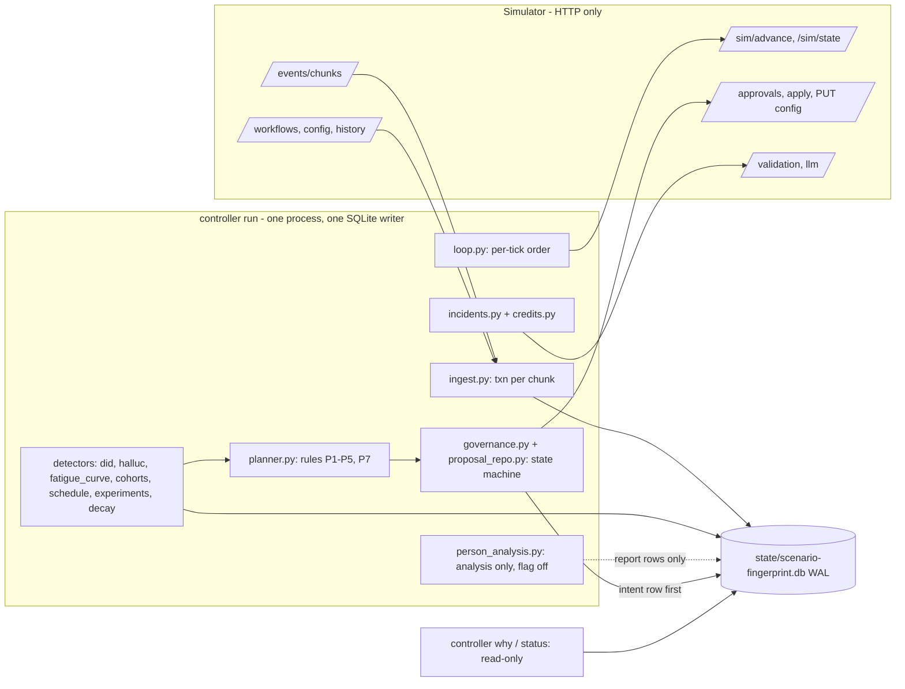

# Outcome-First Agent Loop — Submission

**Name:** Naman Rana · **Date:** 2026-11-07 · **Hours actually spent (be honest):** the work was done with parallel AI agents, so wall-clock and effort differ. Wall-clock span of the repository: 2026-11-06 00:50 to 2026-11-07 05:53 IST, about 29 h from the first commit to the last one before this commit (`git log`). Agent effort: about 33 h, an AI estimate from the git history with compressed commit times, not a stopwatch (`docs/TIMELOG.md`). **Human hours: <candidate to confirm>** · **Language / storage:** Python 3.13, SQLite (WAL)

> Most numbers below come from `reports/`; exceptions are marked inline: a few come from `controller/settings.py`, `docs/THRESHOLDS.md` or `docs/CONTEXT.md`, the design-rate arithmetic in section 7 and the constraint table in section 1 are marked "design" or derived from the code, and the dev-run figures in sections 12 and 13 are marked "dev runs, not committed". The source is named next to each.

---

## 0. TL;DR
- A single-process controller (`python -m controller run`, wrapped by `run.sh`) talks to the simulator only over HTTP. It ingests events into SQLite, partitions leads into cohorts, sets per-cohort call times, runs welcome x voice experiments with promotion, decay and rollback, fixes bad caller IDs and hallucinating prompts, and changes config only through the governance API.
- Results vs a no-op baseline (`reports/public_01.md`, `reports/public_02.md`): public_01 conclusion rate +9.4%, pickup +6.8%, engagement +1.9%, 22 changes (15 neutral, 7 beneficial, 0 harmful); public_02 +22.7%, +19.4%, +1.2%, 23 changes (15 neutral, 8 beneficial, 0 harmful), prompt incident fixed in 135 min. `lapsed`, `apply_conflicts`, `auto_apply_rejected` are 0 in both.
- Crash-safe and deterministic: 6 named fault points injected 11 times plus 10 random hard kills, 22 restarts, all invariants pass and the credits ledger reconciles, on public_02 (`reports/crash_test.log`, wall 314 s) and on public_01 (`reports/crash_test_public_01.log`, wall 277 s); 685 tests, 94% line coverage of `controller/` (`reports/coverage.md`); two concurrent public_01 runs with random hash seeds are row-for-row identical (`reports/determinism.md`). False-winner rate under the null: 1.0% over 800 simulated runs (`reports/mc_null.md`; "null" here is the Monte Carlo, not the dev scenario `null_01`). The dev scenarios `null_01`, `null_02`, `kyc_flag`, `bad_default`, `policy_strict` (a strict hidden-style policy) and `renamed_ids` (all ids renamed) are author-made, live in `devscenarios/`, and are not grader scenarios; their reports are in `reports/dev/`, section 11.
- Scale (`reports/public_03_load.md` and `reports/public_03_load_review2.md`, measured on an 8-core Windows laptop with the simulator co-located, not on a 4 vCPU / 8 GB Linux box): 12 workflows, 840k events per sim day. Day 0 (history ingest plus the first sim day) takes 353 s after the history fast path (`reports/public_03_load_review2.md`; it was 739 s before). Pinned to 4 cores, the full 5-day run stays under 10 min every day: 362 / 268 / 344 / 358 / 423 s (`reports/public_03_load_4core.md`). Live ingest ran at 11,000 events/s in the Day-0 run (near-empty DB) and 6,190 events/s over the 4-core 5-day run (about 5,400 events/s on days 3-4). First thing to break at 10x: SQLite commit and checkpoint of the `calls_lead` index in live ingest.
- Not built: per-person call-time deployment (analysis only, flag off), tenant-fair allocation, prompt experiments outside incidents. Known limits: a decaying ramped arm can stay live (on public_01 nw_renewal W3, a ramped arm that was never promoted, held about 20% share through D6 because its last-24h z never fell below -1; its fall to 0.086 on D7 is W2's promotion applied at D7 14:30, not a decay detection; it was also never removed in the renamed_ids (about 0.20 through D7) and policy_strict (about 0.10 through D7) dev runs, so the limit shows in 3 of the 6 runs that have a decaying arm), and `bad_default` (an author-made dev scenario in `devscenarios/`) has one change graded harmful (sections 11, 13).

## Glossary
- **DID / caller ID**: the phone number a call is placed from. A workflow has a few; a DID's health is its pickup at comparable load.
- **dim**: a config dimension (`welcome_message`, `voice`, `caller_id`, `schedule`, `cohorts`, `prompt_version`). **arm**: one option of a dim in an experiment (voice V2).
- **cohort**: a disjoint group of leads defined on lead features, with its own call-time table. **cell**: one combination of all four lead features. **cube**: our rollup of dials, connects and engaged calls per cell, hour and arms.
- **look**: a scheduled interim test of an experiment. **ramp**: raising an arm from 7.5% to 20%. **harm-stop**: removing an arm at once at z <= -3. **holdout**: the 10% left on the old control after promotion.
- **TV distance / max_shift**: total-variation distance between two allocations (half the summed absolute weight changes); the policy's `max_shift` caps it per cohort per dim for an auto-apply.
- **MDE**: minimum detectable effect the experiments are sized for (10% relative lift, 80% power). **OBF / Lan-DeMets**: O'Brien-Fleming alpha-spending boundaries over interim looks. **Holm**: step-down correction across the arms of a dim. **CUSUM**: cumulative-sum drift detector.
- **MTTR**: time from the incident to the first applied version whose true hallucination rate is at most 1% (the grader's figure). **conclusion rate**: leads concluded over leads uploaded.
- **beneficial / neutral / harmful**: the grader's verdict on each applied change, at apply time: harmful if expected engagement falls more than 1% or DID health more than 2%; beneficial if either rises by more than 1% / 2%; otherwise neutral.
- **floor**: the assignment's mandatory items (runs end to end, audit trail, no broken constraint, complete write-up; `docs/CONTEXT.md` section 9).
- **Labels**: `R1`-`R10` are the hard rules of `docs/CONTEXT.md` section 2 (R1 controller knows only the HTTP API, R2 governance boundary, R3 business owns when to call, R4 KPIs stay separate, R5 deterministic winners, R6 act on populations, R7 audit from our store, R8 credits finite, R9 crash safety, R10 `run.sh` unattended). `C1`-`C15` are the capabilities of the README, scoped in section 2 below (C16 is added there). Planner rules are written "planner rule N" and are `P1`-`P7` in `docs/CONTEXT.md` section 8 (P1 one in-flight approval, P2 priority, P3 operational auto-applies, P4 budget, P5 timing, P6 Day-0 sequence, P7 local validation); the docstring of `controller/planner.py` lists P1-P5 and P7, since P6 is carried out by the Day-0 bundle in `schedule.py`, not by the planner. Prompt versions are also named P1-P5 (a workflow's catalogue); read "planner rule" or "prompt" before the number. Product's priorities are "P0".

## 1. Assumptions
1. **A1** The controller knows only what the HTTP API returns. Sim code was read to learn the contract (validation, grading), never imported by `controller/`, and no hidden-truth numbers are constants.
2. **A2** IST throughout; "Day 3 14:00" = sim minute 3*1440+840 (Day 0 = 2027-01-04, `settings.EPOCH_DATE`).
3. **A3** `*_max_drop: 0.02` is an absolute 2-point drop in the guardrail rate versus the concurrent control (or the pre-change baseline if there is none).
4. **A4** "Who approved" = the workflow's policy approver, identified by `approval_id` and the sim's `decided_at`; the simulator exposes no personal names. `why` says exactly that.
5. **A5** `max_shift` limits the speed of change: at most one auto-apply step per workflow per hour (`AUTO_APPLY_MIN_GAP_MINUTES = 60`), per tick in incident mode (`AUTO_APPLY_INCIDENT_GAP_MINUTES = 15`); steps are never chained within a tick.
6. **A6** Supervisor edits are legitimate and never silently reverted; a revert is proposed through the approver, naming the edit and the evidence.
7. **A7** Anita's limits (<= 2 requests/day, none before 11:00) are a soft preference on top of policy. They are keyed to the workflow id `ks_cancel` (`settings.SOFT_CAPS`) and to the tenant id `kestrel_finance` (`settings.SOFT_CAPS_BY_TENANT`), so every workflow of the Kestrel tenant gets them; a tenant renamed in a hidden scenario would not. The cap is ignored, with a logged `soft_cap_ignored` decision, when approver hours make it unsatisfiable; incidents may use the reserved slot.
8. **A8** Hidden scenarios may change options, policies, incidents, prompts and history length (including 0); everything is read from `GET /workflows` at runtime and each capability has a cold-start rule.
9. **A9** Priors, tunable and documented in `docs/THRESHOLDS.md`: `DID_H_FLOOR = 0.25` (worst plausible health of an untested DID, only used by the probe cap), `DID_PROBE_BASE_STEP = 0.015`, `DID_FLAG_MIN_DROP = 0.12`, `PERSON_PRIOR_STRENGTH = 20`.
10. **A10** Per-look significance levels are tighter than the spec's p < 0.001 because tests re-run every tick: `DID_FLAG_P = 1e-5`, `HALLUC_P = 1e-4`, `HALLUC_P_DRIFT = 1e-5`.
11. **A11** An allocation move below `DID_MIN_TV = 0.005` is not auto-applied, and below `DID_MIN_TV_APPROVAL = 0.03` it is not worth an approval slot.
12. **A12** An applied proposal is monitored for `MONITOR_MINUTES = 1440` and then closed; "closed" ends our monitoring window, it does not certify the change.
13. **A13** Credits: reserve per workflow `min(CREDIT_RESERVE_PER_WORKFLOW = 25, credits_initial / (2 W))` for incidents (W = number of workflows, so at most half the starting balance is held back); one incident spends at most `INCIDENT_CREDIT_CAP = 25`; Day-0 validation of each live prompt at n = 300 (3 credits).
14. **A14** A simulator that restarts is a new world: the DB is keyed by scenario plus the fingerprint of the first history chunk (`world_id.py`).
15. **A15** A supervisor version superseded within one advance cannot be recovered (the API returns no bodies); we mirror bodies after every `config_changed` event and accept the gap.
16. **A16** Welcome and voice are tested only on engagement-primary workflows; hour weights act only per cohort (a single default table does nothing under fixed hourly capacity, `docs/CONTEXT.md` section 3).
17. **A17** A caller-ID allocation last set by a supervisor is treated as owned: no rebalance or spreading over it; only evacuation of a flagged DID, through an approval that names the supervisor's edit (`controller/detectors/did_owner.py`).
18. **A18** Approver latency is uniform on the policy's `approver_latency_minutes` range, as the simulator draws it (`fatigue.decision_probability`); a different distribution would make the filing probability wrong (see the constraint table below).

**Workflows and policies** (the public scenarios, as returned by `GET /workflows`; copied from `docs/CONTEXT.md` section 3). The controller reads these at runtime and keeps no workflow constant except the `ks_cancel` soft cap (A7); hidden scenarios will differ.

| Tenant | Workflow | Primary KPI | Approver hours | Latency | TTL | Max requests / 24 h | Auto-apply dims (max_shift) | mid_flight |
|---|---|---|---|---|---|---|---|---|
| Northwind | nw_renewal | engagement | 10-19 | 30-240 min | 24 h | 3 | schedule, caller_id (0.5) | allowed |
| Northwind | nw_kyc | pickup | 10-18 | 60-480 min | 24 h | 2 | none (`enabled: false`) | next_campaign_only |
| Kestrel | ks_cancel | engagement | 10-19 | 20-120 min | 12 h | 4 | schedule, caller_id, welcome, voice (0.2) | allowed |

All public workflows have a 2 h apply window and `min_validation_pass_rate` 0.97.

**What breaks if a constraint changes.** Each row says what the controller does today (from the code and `docs/THRESHOLDS.md`) and what degrades. "Measured" rows were computed from the code; "tested" rows name the dev-scenario run that exercised them (`devscenarios/policy_strict.yaml`, `devscenarios/renamed_ids.yaml`, results in section 11); "not tested" rows are reasoning from the code, not a run.

| If this changes | What the controller does today | What degrades |
|---|---|---|
| `max_requests_per_24h` 4 -> 1 | One slot: routine and severe requests share it (section 6); the last slot is otherwise reserved for incidents | An incident right after a routine filing waits up to 24 h; one daily bundle is all the change budget there is. Tested for `nw_kyc` only: `policy_strict` gives it 1 request per 24 h (others 2); peak requests per 24 h was 1 on every workflow, and the run applied 9 changes (`reports/dev/policy_strict.md`). A budget of 1 on an incident-heavy workflow is not tested |
| Approver latency is not uniform on the policy range | `fatigue.decision_probability` assumes the sim's uniform draw (assumption A18) and files only at P >= 0.9 (routine) or 0.5 (urgent) | A skewed latency makes P wrong: more requests expire (an expiry still uses a slot), changes land later. Not tested |
| TTL 24 -> 6 h or 2 h | Same rule, plus the urgent fallback (`fatigue.urgent_need`) and the routine fallback (`fatigue.routine_need`: the day's best minutes if P >= `FILE_MIN_P_ROUTINE_FLOOR` = 0.6) | TTL 6 h with approver latency 60-300 min and a 1 h apply window is tested (`policy_strict`: 16 requests, 10 approved, 6 rejected, 0 expired, 0 lapsed; `reports/dev/policy_strict.md`). TTL 2 h: measured with the code: the best filing probability is 0.43 on nw_renewal and 0.145 on nw_kyc, below 0.5 at every minute. Routine work is never filed there (needs 0.9, or 0.6 at the day's best minutes); incidents and severe fixes are filed at the day's best minutes (P >= 95% of the best, floor `FILE_MIN_P_URGENT_FLOOR` = 0.10), so a safety fix still has a 14-43% chance per request and each expiry costs a slot and a hygiene count; only nw_renewal's auto-applies still work for routine changes; ks_cancel (latency <= 120 min) is unchanged; a 1 h TTL on nw_kyc (best P 0.002) files nothing |
| `max_shift` 0.2 -> 0.05 | Auto-apply steps use 0.95 x `max_shift` of TV, one step per 60 min (15 min in incident mode) | A flagged DID holding 14% takes 4 steps instead of 1 to evacuate; experiment entries and harm-stops (7.5-22.5% TV) fail the local pre-check and go to the approver. Not tested |
| `history_days` 0 | Cold start: flat fatigue curve (flag level 1e-7 instead of 1e-5), baselines recomputed daily, Day-0 validation is the hallucination baseline | No cohorts or schedule in the first bundle, slower first changes (C3: cold start exercised in unit tests only) |
| One more DID | An untested DID is probed alone at a share <= ~2% and needs >= 150 dials and 24 h to pass | Each extra DID costs about 2 days before it carries load; fewer tested DIDs to evacuate onto. With a single DID there is no DID logic at all (nw_kyc on kyc_flag) |
| A Kestrel workflow with another id | The soft cap is keyed to the workflow id `ks_cancel` and to the tenant id `kestrel_finance` (`settings.SOFT_CAPS_BY_TENANT`) | A workflow with another id in the same tenant still gets the cap. Only a renamed tenant loses it: Anita's 2/day and not-before-11:00 preference is then not applied; the policy's own request limit still is. Not tested with a renamed tenant (`renamed_ids` renames workflow and option ids, not the tenant; section 11) |
| Auto-apply disabled everywhere | Every change goes through approval, as on nw_kyc | Evacuation of a flagged DID waits for the approver (kyc_flag: flagged share 0.984 -> 0 over about 3 days); more slot pressure. Tested: `policy_strict` has auto-apply off on all three workflows: 0 auto-applies, 9 applied via approval, caller-ID changes graded beneficial (ks_cancel v4 +0.051, nw_kyc v4 +0.230 DID health; `reports/dev/policy_strict.md`) |
| Approver rejects every request (`base_reject_rate` 1.0) | Each judgement rejection is a digest alert and the planner re-plans; the first refile is immediate, from the second rejection of a (workflow, kind) in 24 h the wait is 120 min x (rejections - 1) (`REFILE_AFTER_REJECT_MIN`) | Every request still counts against the 24 h budget, so nothing is ever applied except auto-applies. 1.0 is not tested; 0.25 is (`policy_strict`: 6 of 16 requests rejected, 9 changes still applied) |
| Approver hours wrap midnight (for example 22-06) | A window with `lo > hi` counts as open across midnight (`fatigue.in_hours`); the decision-time model replicates the simulator's `next_working`, which does not special-case a wrapped window (`fatigue.next_working`) | A wrapped window can make the decision-time estimate off, so some requests may expire. Unit tests only, no scenario run |
| Workflow and option ids differ from the public ones | Everything is read from `GET /workflows` (A8); only `SOFT_CAPS` by workflow id is id-keyed, and the tenant key covers it | Tested: `renamed_ids` renames every workflow and option id (tenants unchanged): 15 changes applied, 0 harmful, and results close to public_01 (`reports/dev/renamed_ids.md`) |
| Credits 0 | Incident reserve is `min(25, credits / (2 W))` = 0; Day-0 validation cannot run | No known-good validation evidence, and the approver rejects a prompt change without evidence, so a hallucination incident can be detected and alerted but probably not fixed. Not tested |
| `tick_minutes` 60 | The loop reads the tick from `/sim/state` (`loop.py`); the filing probability multiplies in the chance that the next tick on that grid sees the decision inside the apply window (`docs/THRESHOLDS.md`) | Detection and the audit's `observed_at` lag by up to 60 min instead of 15; a 2 h apply window leaves one tick of slack, and a window shorter than a tick files nothing and raises `apply_window_unreachable`. A 1 h apply window on a 15-min tick is tested (`policy_strict`, 0 lapsed); a 60-min tick is not tested |
| 10x scale | Section 8 | First break: SQLite commit and checkpoint of the `calls_lead` index in live ingest, about 22-26 min per sim day of ingest alone (derived from 6,190 events/s and 156 s/day on the 4-core run) |
| A second writer to the DB | Single writer by design (`BEGIN IMMEDIATE`, busy timeout); no lock file | Two controllers would interleave `plan_seq` and could file competing proposals; the sim's duplicate-id and stale-base checks stop a double apply, the audit trail would interleave. Run one controller per DB |
| `next_campaign_only` on an engagement workflow | Dry run adds the expected next-batch share; experiments read the actual variant of each call | Entry and ramp reach only new campaigns, so experiments are slower and share-regime strata lag the config. Not tested (only nw_kyc, a pickup workflow, has it) |
| `min_validation_pass_rate` 0.99 | Hallucination ceiling 1 - 0.99 = 1% (never below the known-good prompt's own Wilson bound); verify margin is a third of 1 pp | A known-good prompt validated at 0.987 no longer clears the bar without revalidation; more fixes fail verification; impact saturates sooner. Not tested |

## 2. Scope decisions
| # | Capability | Built / Partial / Cut | Why | What it would take to finish |
|---|---|---|---|---|
| C1 | Ingestion at load scale | Built | Spine. One txn per chunk, `event_id` primary key; history ingests without `calls_lead` and with a large WAL, index and flag built in one transaction; live ingest 11,000 events/s on Day 0 and 6,190 events/s over 5 days, Day 0 in 353 s on public_03 (`reports/public_03_load_review2.md`; 5,382 events/s before the fast path, `reports/public_03_load.md`) | Stream chunks (peak RSS 1.49 GB), batch live commits, higher live `wal_autocheckpoint` (section 8) |
| C2 | One shared cohort object | Built | Data-driven partition on one feature or a pair, self-checked against the sim's `cohort_id` on every call | Cohorts beyond the single-pass partition (re-partition during a run is not built) |
| C3 | History bootstrap | Built | Baselines, fatigue curve, flag baselines; cold start recomputes daily | Cold start exercised in unit tests only |
| C4a | Per-cohort call time | Built | Uses history only; schedule-only changes grade neutral | A concurrent control for the before/after check |
| C4b | Per-person call time | Cut (analysis only, flag off) | Eligible persons have at least 4 dials; the posterior is about 90% cohort prior (data weight 9.0 to 10.4%), selection effect, biased holdout (`reports/person_analysis.md`) | A per-person mechanism that does not compete for hourly capacity |
| C5 | Caller-ID health | Built | Biggest pickup lever; the public_02 and kyc_flag incidents | Production weekly re-probe of flagged DIDs |
| C6 | Welcome x voice experiments | Built | Main engagement lever; OBF + Holm + clustered SE | Per-cohort deployment of group winners is wired but rarely reached |
| C7 | Promotion, decay, rollback | Built | Two-stage promotion, sequential decay test, CUSUM, holdout | Decay faster than about 3 days is not separable from noise (section 5) |
| C8 | Hallucination incidents | Built | MTTR is graded: 135 min on public_02, 285 min on kyc_flag | `suggest-fixes` path is implemented but unexercised (0 LLM calls everywhere) |
| C9 | Governance client + planner | Built | Every change goes through it | Cross-workflow coordination |
| C10 | Impact, affected leads, dry run | Built (simple, honest) | `dryrun.py` replays 2-3 days of the cube; unobserved arms labelled `no_evidence` | Honest CI for schedule changes |
| C11 | Supervisor view | Built | `controller view` and read-only `controller ui`, never started by `run.sh` | Authentication, alert routing |
| C12 | Audit store | Built | `why --at / --from --to / --lead` (section 10) | Per-person view |
| C13 | Crash recovery, demonstrated | Built | 6 named fault points injected 11 times + 10 random kills, on public_02 and public_01 (section 9) | Linux box, public_03 kill run |
| C14 | Loop observability | Partial | `metrics`, `tick_phases`, `status`, alert rules; no pager | Pager integration |
| C15 | Fair allocation across tenants | Cut | Budgets are per workflow already; matters at hundreds of tenants | Global coordinator for credits and approver attention |
| C16 | Prompt experiments outside incidents | Cut | Prompts are never in a public `allowed_dims`, every trial would be customer-facing and cost credits; prompts change only through the incident path (known-good revert, sibling check) | A prompt-level experiment design with its own guardrail and credit budget |

**Principle:** spine first (ingest, governance, audit, crash safety), then the levers with the most defensible lift per approval spent (caller-ID health, hallucination fixes, cohort call times, experiments), then reach. Everything optional sits behind a flag in `settings.py`; the one that did not earn its keep (`ENABLE_PERSON_ANALYSIS`) is off.

## 3. Stakeholders
Checked against the workflow policies in `docs/CONTEXT.md` section 3. Each reply is at most 120 words (counted).

### 01 Sales (Nikhil)
- **Accepted:** batching (planner rule 1: one in-flight approval per workflow, one `daily_bundle` per sim day); lift reported per KPI, never blended (rule R4, `docs/CONTEXT.md` section 2).
- **Pushed back:** a blended score; "winning by lunch, live by evening" (minimum sample, sequential boundaries, approver latency 20-480 min, nw_kyc cannot change mid-campaign); rolling P4 out everywhere.
- **Wrong against policy:** ks_cancel auto-apply covers only schedule, caller_id, welcome and voice at max_shift 0.2 (no prompt, no cohorts); nw_kyc has `auto_apply.enabled: false`; P4 is not an option on nw_kyc.
- **Reply:** Nikhil, thanks. Pickup and engagement are reported separately per workflow; there is no blended score. Routine requests are batched, one daily bundle per workflow. "Winning by lunch, live by evening" cannot be promised: a winner needs a minimum sample and sequential test boundaries, and approvals take 20 to 480 minutes in working hours. Two claims do not match the policies: Kestrel's auto-apply covers only schedule, caller ID, welcome and voice, and nw_kyc has auto-apply off. We will not roll P4 out: it is not an option on nw_kyc, and P4 scored a 0.955 pass rate in our Day-0 validation on ks_cancel (9 failures in 200), below the 0.97 bar.

### 02 Compliance (Meera, Northwind)
- **Accepted:** named approval for customer-facing changes (welcome/voice/prompt/cohort changes go through the approver with evidence; the one exception is a risk-reducing harm-stop or rollback of welcome/voice where policy allows auto-apply, section 6); per-customer "why did they hear X" (`why --lead`); no night-time requests (`fatigue.filing_window_ok`); weekly summary of operational auto-applies (`view --weekly`).
- **Pushed back:** zero transient harm cannot be promised. Exposure is capped (7.5% entry, 20% ramp, harm-stop at z <= -3), not removed; the dev scenario `bad_default` (author-made, `devscenarios/`) had one harmful bundle.
- **Wrong against policy:** timing and caller-ID rotation are covered by auto-apply on nw_renewal, not on nw_kyc. The sim exposes no approver names (A4).
- **Reply:** Meera, thank you. Customer-facing changes are approved first, with their evidence, except risk-reducing harm-stops and rollbacks of welcome or voice, which auto-apply only where policy allows (Kestrel; never Northwind) and are listed under "changed today". Requests are never filed at night. `controller why --lead <id>` shows, per customer, each call's welcome, voice, caller ID and prompt, and the approval behind them. A weekly list of auto-applies exists. Correction: timing and caller-ID rotation auto-apply on nw_renewal, not nw_kyc, where your approver decides. We cannot promise zero transient harm: exposure is capped at 7.5% entry, 20% ramp and a harm-stop at z <= -3, and one dev bundle was graded harmful. We record approval ids, not names.

### 03 Platform/SRE (Kabir)
- **Accepted:** kill/restart test (`scripts/crash_test.py`); idempotency (write-ahead proposal ids); health without logs (`status`); under 10 min per sim day (met, including pinned to 4 cores: 268 to 423 s per day); a 10x analysis.
- **Pushed back:** Postgres for the assignment. SQLite is one embedded file and the schema ports (partition `calls` and `cube` by day, shard by workflow); Postgres is the production plan, not something rejected.
- **Reply:** Kabir, the kill/restart test exists (`scripts/crash_test.py`): 6 named fault points injected 11 times plus 10 random hard kills on public_02, 22 restarts, all invariants pass (`reports/crash_test.log`; the same on public_01, `reports/crash_test_public_01.log`); proposal ids are written before sending, so retries are idempotent. Scale was measured on an 8-core Windows laptop with the simulator co-located, not your 4 vCPU / 8 GB Linux target: public_03 stayed under 10 minutes per sim day, also pinned to 4 cores (268 to 423 s). The SQLite file must sit on a persistent volume: losing it loses the decisions audit trail (re-ingest rebuilds data, not decisions). At 2 a.m. the on-call follows `docs/RUNBOOK.md`. Postgres is the production plan.

### 04 Ops supervisor (Anita, Kestrel)
- **Accepted:** never silently undo her edits (A6); soft cap of 2 requests/day and none before 11:00 (applied to workflow `ks_cancel` and the Kestrel tenant, A7); engagement is verified after any prompt change, but a safer-yet-stricter prompt is not blocked up front (a switch that costs engagement is rolled back only after it is applied, section 11); one screen (`view`).
- **Pushed back:** one reserved incident slot beyond her 2/day; operational DID and schedule changes happen without advance notice and appear under "changed today".
- **Wrong / mismatched:** she wants notice before changes, Sales claims Kestrel wants everything automatic; most customer-facing changes reach the policy approver first, so a person is told, but risk-reducing harm-stops and rollbacks of welcome/voice auto-apply on Kestrel and are shown only under "changed today". The memo assumes she is the approver; the sim exposes no names (A4).
- **Reply:** Anita, your edits are never overwritten silently. When your Day 3 prompt edit raised hallucinations, we filed one approval request naming your edit and the numbers, applied it once approved, and verified engagement afterwards; the fix landed 135 minutes after your edit. Customer-facing changes are approved first, except risk-reducing harm-stops and rollbacks of welcome or voice, which auto-apply only where policy allows (Kestrel welcome/voice; never Northwind) and are listed under "changed today". Caller-ID and schedule changes inside policy apply without prior notice and appear under "changed today". Your two-a-day, not-before-11:00 preference applies to ks_cancel and the Kestrel tenant, and is ignored, with a logged decision, if approver hours make it impossible. One extra slot is kept for incidents.

### 05 Product (Tara)
- **Accepted:** separate KPIs; one shared cohort object (documented minimum n and window); every proposal carries summary, rationale, impact, affected leads and dry run; expired = rejection, re-planned with fresh data; only observed arms count; per-workflow promotion.
- **Pushed back:** the three Product P0s cannot all ship at full depth. Per-cohort call time ships; per-person call time is analysis only, with numbers (section 12). Experiments run at the workflow level plus at most 2 pre-registered groups, not per cohort.
- **Wrong against policy:** nothing factual. Prompt changes have no historical dry run and are labelled validation-only.
- **Reply:** Tara, KPIs stay separate everywhere, and one shared cohort object feeds call times and experiments. Each request carries a summary, rationale, impact score, affected leads and a dry run built from observed data; unobserved arms read "no evidence". Expired requests are rejections, re-planned on fresh data. The minimum cohort size costs you fewer per-cohort verdicts; it buys a low false-winner rate (1.0% under the null, `reports/mc_null.md`). Experiments run at workflow level plus at most two groups, not per cohort. Per-person call time is analysis only: the data weight is about 10%, and a no-effect control qualifies 75 to 90% as many people at the same apparent lift. Prompt changes are validation-only.

### 06 CTO (Aryamann)
- **Accepted:** explainable over impressive (deterministic rules, every decision a `decisions` row); credits go to validation, which gates every prompt decision, never to speculative generation; the scale envelope (section 8); a written "no" for each cut (sections 2, 12); on-call docs (`docs/RUNBOOK.md`).
- **Pushed back:** nothing.
- **Wrong against policy:** he warns the memos contain errors; confirmed, listed above.
- **Reply:** Aryamann, you were right that the memos disagree with the policies; the corrections are in the Sales, Compliance and Ops replies. Every change is a deterministic rule and a `decisions` row that `controller why` replays. Credits go to validation, which gates every prompt decision (24 to 30 of 200 per scenario, mostly at Day 0), never to speculative generation (0 LLM fix calls). We cannot promise zero transient harm: exposure is capped by a 7.5% entry, a 20% ramp and a harm-stop at z <= -3, and `bad_default` shows one harmful bundle. Cuts are written down (sections 2, 12). Scale and weaknesses: sections 8 and 13.

## 4. Architecture



Per tick (`loop.py`): reconcile in-flight approvals -> ingest new chunks and mirror configs -> apply approved changes (only if `apply_by` has not passed and the base version is current; otherwise mark LAPSED/STALE locally and never call `/apply`) -> detectors -> planner and submit -> per-person analysis (flag off, never raises) -> metrics row -> advance (15 min; 60 min when idle outside every dialling and approver window). Every tick step (reconcile, apply, plan), detector, producer and apply-time veto runs in its own exception guard: a failure is logged, raises one alert and one decision row per sim day, and the rest of the tick continues. A crashed veto fails safe (a routine change is retried for up to `VETO_CRASH_MAX_RETRIES = 3` ticks, then withheld) but never blocks harm-stop, rollback, evacuation, hallucination or revert kinds (`desired.py`).

**State (SQLite WAL, `controller/schema.sql`, plus `metrics_ext`, which `controller/metrics.py` creates):** `meta` (world fingerprint), `ingest_cursor`, `campaigns`, `leads`, `calls` (event_id primary key), `cube` aggregates, `cohort_defs`, `experiments` + `arms`, `config_versions` (actor, proposal link, mirrored body), `proposals` + `proposal_events` (full state history), `decisions` (every detect/propose/apply with an inputs snapshot), `incidents`, `validation_runs` + `llm_calls` (credit ledger), `jobs`, `detector_state`, `alerts`, `metrics` + `metrics_ext`, `tick_phases` (per-phase timings), `exp_day_cache`.

**Restart behaviour:** open the DB for this world (a changed fingerprint or regressed sim opens a new one), re-read `/sim/state`, reconcile governance (INTENT proposals are looked up in `GET /approvals` by proposal id and resent verbatim if absent; APPROVED ones are applied if still valid; auto INTENTs are matched in `config/history`), re-ingest after the cursor (re-reading a chunk changes nothing) and continue. A world regression noticed mid-run (the simulator restarted or went backwards) makes the controller exit 4 and `run.sh` restart it against a new DB. After a state loss `plan_seq` is seeded from the simulator's approvals and config history, so new proposal ids cannot collide. A lost approval (an `/apply` that never reached the sim) stays APPROVED and is retried after the pre-checks. `run.sh` checks the controller's dependencies, falls back to `pip install --user` and then to a virtualenv (each with a pip timeout and one retry), restarts a crashed controller (cap 20, reset whenever the simulation moved forward during the failed run), gives a restarted controller a 120 s startup wait, and exits 0 only when the controller exits 0, which happens only once the sim reports finished.

## 5. The learning loop
All parameters are in `controller/settings.py` with their derivation in `docs/THRESHOLDS.md`; the decision rule lives in `controller/exp_rules.py`. The Monte Carlo (`scripts/mc_null.py`) shares the decision-rule functions (`exp_rules`, `exp_alloc`, `exp_decay`) with the controller; its lifecycle driver (the 4-hour tick loop, approval latency, simulated data) is a simulation of the controller, not the controller itself.

**Cohorts.** At Day 0 `cohorts.py` scores every single feature and every pair of the four lead features by how much a separate **hour-of-day pickup profile** per group beats one pooled profile (a separable group + hour model is the null, so level differences count for nothing: only profiles that per-cohort hour tables can exploit). A partition must beat the pooled profile at one-sided p < 1e-4 (`COHORT_MIN_Z = 3.72`, which is 1e-3 over 10 candidates) and a pair must beat the best single feature by 2 z, so noise does not fragment traffic. Groups are disjoint (a partition, so first-match order cannot matter); a group below n_min = 100 dials per in-window hour (`COHORT_MIN_DIALS_PER_HOUR`, se_rel 15% per cohort-hour) falls into `default`; at most 20. The cost of that minimum size is fewer per-cohort verdicts and schedules (small groups share the default table); the benefit is a low false-winner rate, 1.0% under the null (`reports/mc_null.md`). On public_02 ks_cancel the result is 4 cohorts by `age_band`. Defining cohorts needs approval (never in a public `allowed_dims`), so it is part of the Day-0 bundle. Every call's `cohort_id` is checked against our own evaluation of that event's config version (`cohort_mismatch` pages).

**Per-cohort schedule (C4a).** Per cohort and hour, an observed/expected pickup multiplier from the last 14 days, controlling for attempt number and campaign day, shrunk by empirical Bayes (tables collapse to the pooled profile when cohorts do not differ). Weights are mean 1, clipped to 0.3-3, every in-window hour present. A dry run re-weights recent dials under fixed hourly capacity and blocks the change if the estimated engagement drop exceeds the workflow guardrail; a refresh needs an estimated gain of at least 0.5%. After apply, hour-mix-adjusted pickup is compared before and after and the schedule is rolled back at a guardrail-sized fall with p < 0.05 (a schedule that is approved and applied on a later day than it was filed is detected through our own proposal, so it is verified and can still roll back; the cohort partition is relearned daily while no cohorts are live; hour tables that came from the business default are refreshable and a rollback restores them, while tables a supervisor wrote are never touched; the check has no concurrent control and says so; public_02 nw_renewal v4 rolled back v3's schedule at Day 0 19:15; see example 6 in `reports/audit_examples.md` and section 10).

**Experiments (welcome x voice, engagement-primary workflows).** Each dial is randomised independently, so the design is factorial and we analyse main effects per dim. Interactions are reported, never acted on: each daily look stores a welcome x voice table (connects, engaged, rate, the rate expected if the two dims were additive, and a z per cell) with an interaction chi-square in its `experiment_look` decision row (`controller/exp_interactions.py`; it reads the cube, and a failure there cannot affect a look). Entry: challengers start at **7.5%** each (at most 22.5% per dim). Options already holding share in the default allocation are **incumbents**: entry and ramps never lower their share, and new challengers are taken from the top option only (`controller/exp_alloc.py`). Entry is skipped, and re-checked daily, when the connects projected for a challenger over the rest of the run cannot reach the minimum a look tests (`EXP_MIN_ARM_CONNECTS_FOR_TEST`). A supervisor edit of the dim before exposure pauses entry for `EXP_SUPERVISOR_COOLDOWN_MINUTES` and drops the pending plan. A step whose `max_shift` is 0 or less is not auto-applied; it goes to approval. **Ramp:** after at least 1 day and 100 connects an arm with a non-negative point estimate goes to 20%, control never below 40%; a bad recent window blocks the ramp (last-24 h z <= -1 on at least 50 recent connects, `EXP_RECENT_MIN_CONNECTS`), at the look and again at apply, because a 7.5% arm sees too few connects a day for the 100-connect rule alone. **Drop:** whole-experiment z <= -1.5 below 300 connects, <= -1 above, and a ramped arm also at last-24 h z <= -1.5. At apply time a drop is vetoed only if the arm clearly recovered (hysteresis: a ramped arm's last-24 h z above -1, or cumulative z more than 0.5 above the drop bound), so a noisy window cannot flip a drop back and forth. **Harm-stop** every 4 h: z <= -3 with >= 150 connects removes the arm at once. It is computed on the live split, so it never carries an unapproved ramp live; the pending update is superseded with a decision row. Unit: the connected call with **per-lead clustered (sandwich) standard errors**, Mantel-Haenszel pooled over day x share-regime strata so ramps and base-rate drift do not confound. **Winner:** one-sided test at looks when information reaches 0.25/0.5/0.75/1 of the design value (10% lift, 80% power), **Lan-DeMets O'Brien-Fleming** boundaries, **Holm** across the arms of a dim, familywise 0.05 per workflow split over the two dims (workflow-level 0.02 plus two pre-registered traffic groups at 0.0025 each, per dim). Promotion also needs point lift >= 3%, the **recent-24 h one-sided 95% lower bound > 0** (never promote a variant that has begun to decay), and a **non-inferiority guardrail** on pickup (clustered difference, upper bound of the drop under the policy's `pickup_rate_max_drop`). Exploration vs exploitation: a fixed-horizon sequential design with a conservative ramp, not a bandit (section 12).

**Two-stage promotion and holdout.** Stage 1: winner 50% / old control 50% (a half-power concurrent control for a variant that never carried real traffic). Stage 2: 90% / 10% holdout only after >= 24 h at stage 1, a positive recent lower bound and a positive concurrent contrast. Both stages are customer-facing and go through approval. Before `/apply` of any approved ramp, drop or promotion stage an **apply-time veto** re-checks the evidence (recent-24 h one-sided 80% lower bound > 0 for promotions); a withheld change is never sent to `/apply`, so no lapse is logged. A withheld or approver-rejected drop puts the arm back into the experiment instead of orphaning it, and every tick `exp_reconcile.py` compares the intended split with the live config and re-files a change that never landed. A bundle that carries a risk-reducing harm-stop or rollback is never withheld because another dimension's part went stale (that part is applied and logged as `experiment_stale_part_applied`).

**Decay and rollback.** A sequential winner-vs-control test (level 0.10 per epoch, OBF, epochs restart when information reaches that of a -15% effect at 80% power) plus a **CUSUM** of the winner's composition-adjusted engagement (blocks of 150 connects, k = 0.5, h = 3) that needs the holdout's recent direction to agree. A rollback is risk-reducing: auto-apply where the dim is allowed, else the second-to-last approval slot, superseding any routine request in flight. Measured limit (`reports/mc_null.md`, 250 runs per row; a promoted winner whose lift falls from +15% to -10% over 2 days from a random onset):

| Decay setting | Promoted (stage 1) | Rolled back | Median ticks stage 1 -> rolled back (4 h each) | Share <= 0.1 two days after onset |
|---|---|---|---|---|
| approval 2 h, rollback by approval | 24.4% | 24.0% | 13 | 16.4% |
| approval 8 h, rollback by approval | 20.0% | 20.0% | 12 | 9.6% |
| approval 20 h, rollback by approval | 9.6% | 9.6% | 14 | 2.0% |
| approval 8 h, rollback by stepped auto-apply | 20.0% | 20.0% | 11 | 12.4% |
| approval 8 h + base-rate drift, rollback by approval | 16.0% | 16.0% | 12 | 8.8% |

"Rolled back" is out of all runs, so it equals "promoted" except one run of 250 in the first row. Detection time is the median in the penultimate column (11-14 ticks of 4 h, 44-56 h) after stage 1. A decay faster than about 3 days is not separable from noise at a 20% share. **How this relates to the graded W3 case:** the Monte Carlo measures a *promoted* winner that decays; W3 on public_01 was a *ramped* arm that was never promoted, so it never reached the CUSUM and holdout path at all and was judged only by the ramped-arm drop rules (previous paragraph).

**Decay limit seen in a graded run.** On public_01 the decaying nw_renewal W3 arm was a ramped arm that was never promoted. It kept about 0.20 share through D6 and fell to 0.086 on D7 (`reports/public_01.md`); that D7 fall is W2's promotion applied at D7 14:30, not a decay detection (`reports/decay_diagnosis.md`). On public_02 it was 0.033 on D6 and 0 from D7 (`reports/public_02.md`). W3's last-24 h z on public_01 never fell below -1 (+1.07, -0.11, +0.54, +0.87 on days 3-6 on about 200 recent connects each, from the controller's own `experiment_look` rows; `reports/decay_diagnosis.md`). None of the rules we tried would have removed it without also dropping null arms: the ramped-arm drop at recent z <= -1.5, the apply-time block at recent z <= -1 on >= 50 connects, and a looser "recent point lift <= 0" rule, which on the null_01 state databases flagged 8 of 8 and 5 of 5 ramped null arms (`reports/decay_diagnosis.md`). A bug that orphaned a withheld drop was found and fixed; the shares above are after the fix.

**False-winner rate (`reports/mc_null.md`, 800 null runs; reproduce with `python scripts/mc_null.py --runs 800 --power-runs 300 --decay-runs 250`):** 1.0% any-arm false promotion (target <= 5%); 1.0% of 800 is 8 runs, whose exact binomial (Clopper-Pearson) 95% interval is 0.43% to 1.96% (derived here from the report's rate, not printed in it); 0.2% on arm A, 0.8% on B. A scenario has 4 experiments (2 workflows x 2 dims), so at least one false promotion per scenario is about 4x that. Power: a +10% arm is promoted in 34% of runs, +15% in 63%, median day 4.8-5.8. Stratified and unstratified contrasts false-promote at the same rate (1.3% each) at +-5% drift.

**Caller ID (C5).** A monotone fatigue curve (pickup ratio vs trailing decayed dial volume, decay window chosen from `DID_FATIGUE_TAU_GRID_DAYS` by fit; nothing taken from the sim). Flagged DID: a step drop vs peers (or vs its own 48 h history when it has no peers) at `DID_FLAG_P = 1e-5`, >= 150 dials a side, relative drop >= 12%, holding for 2 evaluations. Probes of new DIDs at share `s <= 0.015 h/(h - 0.25)` (about 2%), so the worst-case DID-health step stays above the -2% harmful line; weak bases need two distinct days. Evacuation in steps bounded by `max_shift`; a flagged DID whose auto step would fall below the minimum TV (`DID_MIN_TV`) is evacuated through an approval instead of stalling. **Guard on every non-safety move:** a spread, ramp, probe or weak-base rebalance is proposed only if the expected DID health does not fall by more than `GUARD_TOLERANCE` (`controller/detectors/did.py`, equal to `DID_PROBE_BASE_STEP` = 0.015; a weak-base rebalance must gain); otherwise a decision row says why it was refused. Expected health uses the learned curve for tested DIDs and the `DID_H_FLOOR` = 0.25 prior for unknown ones, never 1.0. A change carries at most one untested or re-probed DID. A re-probe of a DID whose flag expired is capped by `DID_REPROBE_HARM_BUDGET` = 0.005 (a quarter of the 2% line, `docs/THRESHOLDS.md`).

**Hallucination.** A flag-rate test per prompt segment against the last known-good prompt (Day-0 validation, n = 300) with an absolute ceiling of `1 - min_validation_pass_rate` that is never set below the known-good prompt's own measured flag rate (Wilson upper bound), so detector false positives in the baseline do not open incidents; a supervisor edit starts a new segment at once. Fix: revert to the workflow's own known-good prompt using its Day-0 validation as evidence (no new credits); a known-good prompt whose stored validation is borderline (below the bar by at most 2 standard errors, n under 300) is revalidated once at a larger sample before it is used. **Sibling-prompt safety check:** at Day 0 up to 3 sibling catalogue prompts are validated (2 credits each); the live prompt is switched only if a sibling is clearly safer (one-sided 95% Wilson bounds) and the live failure bound is at least half the policy tolerance; after apply the switch is verified and rolled back on failure. Paid `suggest-fixes` results that are still pending are validated later and never paid for twice. After a failed fix, the workflow's other known-good prompts are tried before any suggestion is bought. A known-bad prompt that becomes live again reopens an incident instead of leaving a blind spot. When every catalogue prompt validates below the bar, no more validations or suggestions are bought (`prompt_bar_unreachable`).

**Call time and caller ID, per-cohort vs per-person.** Call time is per cohort from history, no exploration. Per-person is analysis only (section 12). Caller ID explores by capped probes, never by random assignment.

**Guardrail KPI.** Experiments: the non-inferiority test above. Schedule: the dry-run engagement cap plus the before/after check. Reporting caveat: engaged/connected falls a little whenever pickup rises (repeat connects are by construction people who did not engage the first time); on null_01 the dip was -0.5 to -1.2 pp, z -0.7 to -1.1 per workflow, first-connect engagement unchanged (`reports/guardrail_analysis.md`, run on an earlier null_01 run; the final null_01 grade is -1.3% overall, `reports/dev/null_01.md`). Experiment tests compare arms within the same period, so they are not exposed; day-vs-baseline KPI views are.

## 6. Governance
**State machine** (`proposal_repo.py`): `DRAFT -> INTENT -> PENDING -> APPROVED -> APPLIED -> MONITORING -> CLOSED`; auto path `INTENT -> AUTO_APPLIED -> MONITORING -> CLOSED`; branches `REJECTED` (reasons stored, planner re-plans), `EXPIRED` (treated as a rejection, new id on fresh data), `STALE` (base changed: re-plan, re-read any supervisor edit, never call `/apply`), `LAPSED` (`apply_by` passed: should be impossible, alerts), `SUPERSEDED`, `SUBMIT_FAILED`. The proposal id `workflow:plan_seq:kind` and the full body are written before anything is sent.

**Batching and timing.** One in-flight approval per workflow (planner rule 1); a `daily_bundle` once per sim day carries every wanted change (cohorts, schedules, experiment ramp/drop, promotion stages) in one request. Requests are filed only inside approver hours and only if the probability that the decision lands before `expires_at` is high enough: `fatigue.decision_probability` (latency is uniform on the policy range) must be at least 0.9 for routine requests (`FILE_MIN_P_ROUTINE`) and at least 0.5 for incident and severe ones (`FILE_MIN_P_URGENT`); if no minute of the day reaches 0.5, incident and severe requests are filed at the day's best minutes provided that best is at least 0.10 (`FILE_MIN_P_URGENT_FLOOR`), because never filing guarantees the fix never lands. This replaces the earlier worst-case rule, which starved short-TTL policies; on the public policies the two agree. The rolling 24 h ledger has three **slot tiers**: the **last slot is reserved for safety incidents only** (hallucination fix, flagged-DID evacuation where auto-apply is off); harm-stop and rollback may use the **second-to-last**; routine bundles get **max(1, max - 2)**. A rollback therefore never blocks a safety fix, and a collision merges into one superseding proposal. With a budget of 1 request per 24 h, routine and severe requests share the single slot (otherwise the controller could never act except for incidents); the trade-off, documented in `docs/THRESHOLDS.md`, is that an incident arriving right after a routine filing waits up to 24 h. The soft cap of 2/day and not-before-11:00 applies to `ks_cancel` and to the Kestrel tenant (A7). A routine request files at the day's best minutes when no minute reaches P 0.9, provided the best P is at least `FILE_MIN_P_ROUTINE_FLOOR` = 0.6. The filing probability also includes the chance that the next tick on the tick grid sees the decision inside the apply window; if the window cannot be reached nothing is filed and `apply_window_unreachable` is raised once a day. Repeated judgement rejections of one (workflow, kind) back off: the first refile is immediate, from the second rejection in 24 h the wait is `REFILE_AFTER_REJECT_MIN` = 120 min times (rejections - 1). Wrapped approver windows (for example 22-06) count as active. An approval that vanished from `GET /approvals` raises an `approval_missing` alert once a day and is marked EXPIRED (a re-plan) once it is past its expiry plus one tick. Each tick step (reconcile, apply, plan) runs in its own guard: a failure raises `tick_step_failed` once per sim day and the tick still advances, so one unusual hidden shape cannot exhaust `run.sh`'s restart cap. A failed submit backs off for `SUBMIT_FAILED_BACKOFF_MIN` = 240 sim minutes (30 for an incident on the approval route).

**Supersede.** A higher-priority need while something is in flight produces one proposal that contains the new change plus every still-wanted change from the in-flight one, using the reserved slot; whichever is approved first and still valid is applied and the other is marked `SUPERSEDED` and never applied. Example: public_02 ks_cancel v9 is a hallucination fix that also carries the pending voice ramp (section 10). **Why bundling a safety fix with still-wanted experiment changes is safe:** the approver sees every part, with its diff and evidence, in one request, so nothing is approved unseen; the apply-time veto still re-checks each part and withholds a stale one while never withholding the risk-reducing part (`experiment_stale_part_applied`); and splitting would spend a second approval slot, of which there are few (max 4 per 24 h, and the last is reserved for incidents). **The alternative** is two requests: the safety fix alone in the reserved slot and the experiment change re-filed later, which keeps each decision simpler to audit and lets the approver reject one without the other, at the cost of a slot and of delaying the experiment by a filing cycle. `bad_default` suggests a cost of bundling: the grader scores a bundle as one change (section 11).

**Auto-apply, and when we voluntarily do not.** Auto-apply only for operational changes (caller ID, schedule) and risk-reducing ones (harm-stop, rollback) where the policy allows the dim and the per-cohort-per-dim TV is within `max_shift`. Customer-facing changes are approved first (welcome and voice entry, ramp, drop and promotion; prompts; cohorts, which are never auto-applied), even where welcome and voice could be auto-applied, because a named approver is what Compliance asked for. The exception: a risk-reducing harm-stop or rollback of welcome or voice auto-applies where the policy allows it (Kestrel's ks_cancel; never on Northwind), and it is listed under "changed today" on the one-screen view. nw_kyc has auto-apply off, so its caller-ID changes are approvals. The approver is the workflow's policy approver; we do not assume who that is (A4).

**Local validation.** Every field the approver checks softly (empty summary, diff, rationale or dry run, non-integer `affected_leads`, impact outside [0, 1], missing prompt evidence, fatigue) and the auto-apply policy are checked before sending (`governance.py`), so 4xx and graded 403s should not occur: `auto_apply_rejected` is 0 in every report.

**Impact, affected leads, dry run, honesty.** `impact_score = clip(lower-bound relative lift on the primary KPI x share of traffic affected / 0.10, 0, 1)`; safety fixes use an override: excess hallucination rate over the policy tolerance for a prompt fix, and traffic moved off a flagged DID times its estimated pickup deficit for an evacuation (`docs/THRESHOLDS.md`; the sim's approver only checks that impact is in [0, 1]). `affected_leads` counts active in-cadence leads whose effective distribution changes. The dry run replays 2-3 days of the cube at observed per-arm rates under the new weights with a CI; unobserved arms are `no_evidence`; prompt changes are `validation-only`. It is an observational replay, not a causal estimate.

**Reconciliation and crash safety.** At startup and every tick, `GET /approvals` and `config/history` are matched by proposal id: an INTENT is resent verbatim only if absent; an APPROVED proposal is applied only if `apply_by` has not passed and the base version is current; a supervisor edit between propose and apply makes it STALE; an `/apply` that never reached the sim leaves the proposal APPROVED and it is retried after the same pre-checks. Credit-costing calls have their own crash point and ledger reconciliation (section 9).

**Supervisor edits mid-experiment.** The affected dim is marked interrupted; earlier data stays valid for arms that ran; the edit is never re-imposed over. After `EXP_SUPERVISOR_COOLDOWN_MINUTES` the supervisor's choice is the new control and the next `change_summary` says so; arms that were behind the new control are not re-entered. On public_02 nw_renewal the supervisor set voice to V2 only (v11 at Day 5 15:00): the controller did not revert it. A supervisor's caller-ID allocation is likewise owned (A17): it is never rebalanced, only evacuated of a flagged DID through an approval that names the edit.

## 7. Incidents
**Thresholds** (`controller/settings.py`, derivations in `docs/THRESHOLDS.md`): flagged DID `DID_FLAG_P = 1e-5` per look with 1/2/3/6 h windows, >= 150 dials a side, drop >= 12%, 2 consecutive evaluations; hallucination `HALLUC_P = 1e-4` (fresh segment) and `1e-5` (drift) with >= 200 connects. The levels are tight on purpose because tests repeat every tick.

**Incidents in scenarios with no injected incident** (the `incidents` table of each final run's state database, `state/devr3_*` for the dev scenarios; `state/` is git-ignored, so this count is not in a committed report): public_01 0 incidents; public_02 2 (both real, the graded D2 flag and the supervisor prompt edit); kyc_flag 2 (both real); bad_default, null_02, policy_strict and renamed_ids 0 each; null_01 **1 flagged-DID incident on nw_kyc at Day 0 13:00 (a single-DID workflow, own-history step test: pickup 0.257 in the 6 h window against 0.370 in the reference, p = 5.0e-07)**, with no graded incident in that scenario (`reports/dev/null_01.md`: Incidents `[]`). That is 1 flagged-DID incident in the 6 final runs with no injected DID incident (public_01, bad_default, null_01, null_02, policy_strict, renamed_ids). It is not clearly a false positive: `null_01` has no injected effects or incidents, but the simulator's load fatigue is still active, so a DID that carries all of a workflow's dials can lose pickup for real; the nw_kyc caller-ID spreads that followed are fatigue relief, not noise. It was handled by evacuation steps and no applied change was graded harmful. A calibrated rate is not claimed; 6 runs is too few. **Design false-positive rate (design, not measured):** each look flags at p < `DID_FLAG_P` = 1e-5, with about 130 looks per DID-day (1/2/3/6 h windows each tick, `docs/THRESHOLDS.md`), so a union bound gives at most 130 x 1e-5 = 1.3e-3 (0.13%) per DID-day; the 2-evaluation persistence rule, the 12% effect gate and the stricter 1e-7 level while the fatigue curve is unfitted only lower it. This assumes calibrated p-values and independent dials; clustering and load drift break both, so the observed incident is not comparable to it.

**Choosing a fix:** revert to the workflow's own known-good prompt (its Day-0 validation is the evidence, so no new credits); only if none exists, `suggest-fixes` plus validation ranked by lowest failure upper bound (implemented, 0 LLM calls in every run). **Credit spend** (of 200 per scenario; `reports/public_01.md`, `reports/public_02.md`, `reports/dev/*.md`): public_01 24 credits (10 validation runs), public_02 26 (11), kyc_flag 29 (12), null_01 30 (12), null_02 24 (10), policy_strict 30 (12), renamed_ids 30 (12), bad_default 30 (12), 0 LLM fix calls. These are Day-0 validations of live prompts and the sibling-prompt safety checks, spent proactively rather than only when an incident fires.

**Verify after apply:** a relative incident (the live prompt against its own earlier segment) needs the new prompt's flag rate non-inferior to baseline (margin a third of the policy tolerance, between 400 and 1,500 connects, waiting if unresolved) and engagement inside the guardrail. An absolute incident (the Day-0 bad prompt or a ceiling breach) needs the one-sided 95% Wilson upper bound of the fix's flag rate to sit under the effective ceiling, and its engagement compared with the bad prompt's own engagement (skipped when the bad prompt has too few connects). A failed check moves to the next candidate; a DID incident closes when the flagged DID's observed share is under 0.5%.

**Timeline, public_02 ks_cancel Day 2 to Day 4**, assembled from the `why` outputs of the graded run (`reports/audit_examples.md` examples 4, 5, 7 and 10; `state/final3_02`; experiment looks omitted):
```
  Day 2 11:45  did_flagged: FLAGGED D2: pickup ratio vs peers fell 69% (p=3.6e-07, 244 dials in 2h vs 1916 in the reference); incident mode
  Day 2 12:00  proposal_auto_applied: ks_cancel:7:did_evacuation -> config v7 (controller_auto, caller_id): D2 14.3% -> 0.0%
  Day 2 23:00  incident_closed: D2 evacuated: observed share 0.00% over the trailing window, config v7 share 0 in every key
  Day 3 11:30  config_observed: v8 by supervisor changed ['prompt_version']
  Day 3 11:45  incident_opened: halluc  (bad_prompt_day0: P2 flags 5.5% vs failed Day-0 validation, n=200)
  Day 3 11:45  proposal_pending: ks_cancel:9:halluc_fix            (revert P2 to P1, validation val_00001 pass 0.987)
  Day 3 13:45  proposal_approved + applied -> v9 (controller_approved; approver decided 13:26)
  Day 3 17:30  incident_verified: P1: flags 1.23%, engagement ok; incident_closed
  Day 4 11:45  did_flag_expired: D2 re-probed at the re-probe cap (v10, controller_auto)
```
The grader reports `mttr_minutes: 135`, `fixed_by: controller_approved`, flagged-DID share by day 0.081 (Day 2), 0.0 (Day 3), at most 0.009 afterwards (`reports/public_02.md`). The 135 minutes are the supervisor edit (11:30) to our apply (13:45); detection took 15 minutes and the approver decided at 13:26. On kyc_flag (a supervisor prompt edit on nw_renewal at Day 4 12:00) the grader's MTTR is 285 min with `fixed_by: controller_approved` (`reports/dev/kyc_flag.md`); I did not break that figure down further. Evacuating a flagged DID on single-DID nw_kyc is slow: kyc_flag's flagged-DID share was 0.984, 0.616, 0.333 and 0 over D3-D6 (about 3 days), because nw_kyc applies changes at the next campaign.

## 8. Scale
From `reports/public_03_load.md` (12 workflows, 840,000 events per sim day, 5 sim days run to the end, before the history fast path) and `reports/public_03_load_review2.md` (Day 0 only, after it). **Measured on a Windows 10 laptop with 8 cores, simulator and controller on the same machine, SQLite on local disk. It was not measured on the 4 vCPU / 8 GB Linux target.** The per-day wall times below include the simulator's own compute.

| Metric | Measured |
|---|---|
| Wall per sim day (incl. sim compute) | **Day 0: 353 s (5.9 min)** after the history fast path, run alone on the laptop (`reports/public_03_load_review2.md`); it was 739 s before. Days 1-4: 380 / 422 / 499 / 504 s (6.3 to 8.4 min) before the fast path (`reports/public_03_load.md`); on 4 cores with the current code, days 0-4 are 362 / 268 / 344 / 358 / 423 s (`reports/public_03_load_4core.md`; that run is ungraded) |
| Ingest | Day 0 after the fast path: 11,000 events/s live (840,047 events, 77 s inside ticks; `reports/public_03_load_review2.md`). Before it: 5,382 events/s over all 5 days (4.20M events, 780 s inside ingest; `reports/public_03_load.md`) |
| Controller time per tick | p50 1.74 s, p95 13.5 s, max 69.5 s (15 sim minutes per tick; 5-day run before the fast path) |
| End-to-end decision lag | p50 1.7 s, p95 13.5 s, max 69.5 s (against 2 h apply windows) |
| Peak RSS | 1,422 MB in the 5-day run, 1,486 MB in the Day-0 run; both reached while ingesting the history chunks at start-up (steady-state RSS was not sampled separately) |
| DB | 892 MB after history (782 MB after the fast path), then about 120 MB per day (1.38 GB, 7.43M `calls` rows, 5-day run). While history is ingested the WAL grows to about 1 GB before it is checkpointed, so plan for about 1 GB of extra free disk (`reports/public_03_load_review2.md`) |
| Outcome | rc 0, 70 changes applied (33 beneficial, 37 neutral, 0 harmful), `lapsed` 0, `apply_conflicts` 0, `auto_apply_rejected` 0, 100 of 400 credits (from the pre-fast-path 5-day run, `reports/public_03_load.md`; the 4-core run was not graded) |

**On 4 cores, current code (`reports/public_03_load_4core.md`).** The whole 5-day run was pinned to 4 cores, with simulator and controller sharing them. That approximates the 4 vCPU target but not its 8 GB limit or Linux.
- Every sim day stayed under 10 minutes: Day 0 took 362 s and days 1-4 took 268 / 344 / 358 / 423 s.
- Live ingest ran at 6,190 events/s. Tick wall (decision lag) was p50 1.74 s, p95 13.1 s and max 64.5 s. Peak RSS was 1,485 MB.
- The controller exited with rc 0 at the end of the scenario.
- Per-day time still grows (ingest 130 s on Day 1 to 156-161 s on days 3-4), so a much longer run would need the partitioning below.

Before the profile-driven fixes (cell-filter `EXISTS` instead of `IN (SELECT ...)`, cached completed-day arm counts, cached schedule strata) days 3 and 4 took 700 and 772 s, over the target; detector time halved (1,144 s to 570 s). The 4-core run above was pinned to 4 cores on Windows, which is not the Linux target. It shows that the simulator and controller fit inside 10 minutes per day on 4 cores, but it is not a guarantee on the target box.

**What breaks first at 10x (about 8.4M events/day):** (1) SQLite commit and checkpoint of random `calls_lead` index pages in live ingest. The history fast path ingests history without that index and with a large WAL (about 1 GB), then builds the index and the `calls_index_built` flag in one transaction, and live chunks never run before it (crash-tested, `reports/public_03_load_review2.md`); that fixed Day 0, not live ingest. Live ingest ran at 6,190 events/s over the 5-day 4-core run (about 5,400 events/s on days 3-4, 156 s per 840k-event day; `reports/public_03_load_4core.md`), so 10x (8.4M events) is about 22-26 min of ingest per sim day (8.4M / 6,190 = 1,357 s; 156 s x 10 = 26 min; derived, assuming the rate holds at 10x; not measured). The 11,000 events/s Day-0 figure is on a near-empty DB and is not a steady-state rate. Before the fast path, about 85% of live ingest time was inside `COMMIT` in a replay and a higher `wal_autocheckpoint` gave 23.8k events/s (`reports/public_03_load.md`); that split was not re-profiled. `json.loads` is not the limit (124k events/s per core, same report); (2) per-tick detector queries over a `calls` table that stops fitting the page cache (about 14 GB per 5 days); (3) memory, because whole chunks are materialised (a 10x morning chunk is about 540 MB of text; stream it); (4) the simulator itself (90 to 190 s per day, not ours). **Partitioning:** shard by workflow (all state, approvals and DID pools are per workflow; only the credit pool is shared, so give each shard a reserved share plus a shared top-up), one process and one DB per shard of 2 to 4 workflows, each pre-filtering lines on `workflow_id` before parsing, batched commits across chunks and an explicit checkpoint on idle ticks; beyond that Postgres or a column store for `calls` with the same keys. The live-ingest changes (streaming, batched commits, larger checkpoint interval for live chunks) were not applied: they deserve their own crash-test run.

## 9. Reliability
**Method** (`scripts/crash_test.py`, subprocess only): start `python -m sim serve` for public_02, run `python -m controller run` as a subprocess, and (a) for each fault point in `controller/faults.py` run with `CRASH_AT=<point>:<n>` until the process `os._exit`s (rc 137, no cleanup handlers), then restart; (b) 10 `Popen.kill()` hard kills after seeded random wall delays; (c) run to completion and check invariants over HTTP, the sim's grader and our store. The 6 fault points: `mid-ingest-txn`, `after-submit-before-record`, `after-apply-before-record`, `after-advance-before-ingest`, `after-credit-call-before-record` (a kill between a credit-costing call and its ledger row) and `before-apply-request` (between the `apply_intent` log and the `/apply` POST).

**Result** (`reports/crash_test.log`, Windows 10, Python 3.13, seed 7; produced by `python scripts/crash_test.py`, whose defaults are the public_02 scenario, 10 random kills and seed 7): the 6 named fault points were injected 11 times (all 11 fired), all 10 random kills were delivered mid-run, 22 restarts, controller finished rc 0 (wall 314 s) and the sim reached `finished` (sim minute 14,400). The same test on public_01 (`reports/crash_test_public_01.log`, `--scenario scenarios/public_01_dev.yaml`): 11 of 11 fault points, 10 random kills, 22 restarts, wall 277 s, sim minute 11,520, all invariants pass. The public_02 output:
```
INVARIANT PASS: every named fault point fired -- fired=11 of 11
INVARIANT PASS: every controller_* config version maps to a unique proposal_id -- 22 versions checked; bad=[]
INVARIANT PASS: no duplicate applies in our store -- duplicates=[]
INVARIANT PASS: grade: lapsed 0, apply_conflicts 0, auto_apply_rejected 0
INVARIANT PASS: every proposal is terminal/consistent with GET /approvals; no approval lost -- 24 proposals, 13 approvals
INVARIANT PASS: ingest cursor monotonic across restarts and == sim last_event_id at the end -- final=324341 sim=324341
INVARIANT PASS: credits ledger reconciles: initial=200.0 sim_remaining=184.0 ledger=16.00 of which unrecorded-at-crash=5.00
INVARIANT PASS: experiments were active (experiment_* proposals exist for the kills to land on)
RESULT: ALL INVARIANTS PASS
```
**What state is lost:** nothing committed. An interrupted chunk transaction rolls back and the chunk is re-read; an advance that returned before the crash is found by re-reading `/sim/state`; caches are rebuilt from SQLite. A kill inside a credit call can leave the spend unrecorded; startup reconciles the ledger against the sim's `credits_remaining` (5 credits were found unrecorded in this run and are booked as such). **Not shown:** the Linux grading box, public_03 under kills, and a SQLite file corrupted on disk (the runbook covers it: re-ingest from the simulator, losing our `decisions` rows and detector state). The SQLite file therefore has to live on a persistent volume: losing it loses the decisions audit trail, which re-ingest cannot rebuild.

**Idempotency keys:** `proposal_id = "{workflow}:{plan_seq}:{kind}"`, written with the full body before anything is sent; the sim rejects a duplicate id with 409 and we adopt the existing approval. After a state loss `plan_seq` is seeded from the sim's approvals and config history so ids do not collide. An INTENT row is matched against `GET /approvals` (or `config/history` for auto-applies) and resent verbatim only if absent. Ingest is idempotent on `event_id`.

**Simulator 4xx/5xx** (`controller/client.py`): 5xx and transport errors on reads retry with exponential backoff (`RETRY_ATTEMPTS = 5`, 0.5 s doubling to 8 s), then `SimUnavailable`. `POST /sim/advance` is never retried: on failure we poll `/sim/state` until `sim_minute` is stable across two reads (or raise `AdvanceNotApplied`; the loop gives up after 5). Mutating and credit-costing calls are attempted once; a transport or 5xx failure raises `OutcomeUnknown` and governance reconciles by lookup. 4xx are typed and never retried: 409 duplicate adopts the approval; 409 stale base is STALE and re-plans; 409 `not_approved` reconciles; 409 `finished` exits 0; 410 is LAPSED plus an alert; other 4xx on submit is `SUBMIT_FAILED` plus an alert and a backoff.

**Tests.** 685 tests pass; line coverage of `controller/` is 94% (`reports/coverage.md`, `pytest-cov`, dev-only). The lowest modules there are `detectors/prompt_safety.py` (76%), `audit_story.py` (81%), and `__main__.py` and `view.py` (83% each).

**Determinism (`reports/determinism.md`).** Final verification at commit c556fce: two clean concurrent public_01 runs with random `PYTHONHASHSEED`s are identical: `decisions` (2,545 rows), `proposals` (24), `config_versions` (25), `alerts` (3) and the grade JSON (14,139 bytes); the graded `run.sh` run (`state/final1`) matched run A. The check originally failed (first divergence at Day 1 15:15): the planner built allocation dicts in string-hash order and the simulator samples options in the dict's key order. After sorting keys everywhere (`configlib.normalise_weights`, `did_plan`, float sums over sets) the runs match. `reports/determinism.md` was verified at that older commit. Since then the grades of public_01 and public_02 were re-produced byte-identically at commits `a6669e2` and `df037bf` through `c69c4f9`, by independent runs; each run is its own process, and `scripts/dev_run.sh` does not set `PYTHONHASHSEED`, so Python randomises it per process (these re-runs are not in a committed report).

## 10. Audit & observability
All modes read only our SQLite store (`--db FILE`, or the newest DB in `--state-dir`; `--json`). Real output from the re-run graded runs `state/final3_01` (public_01) and `state/final3_02` (public_02), copied from `reports/audit_examples.md` (ten examples there, regenerated with `scripts/gen_audit_examples.py`); long lines are cut. **Audit durability:** the audit trail is the `decisions`, `proposals` and `config_versions` tables of the SQLite file, so the file must live on a persistent volume (also said in section 9 and `docs/RUNBOOK.md`); the production plan in section 14 mirrors `decisions` to Postgres.

**Cost and safety of the observers.** Per-tick alert and metric queries never scan `calls` (the newest call minute comes from the primary key; stall and starvation checks read the cube; starvation is checked once per sim day). Each alert rule runs in its own guard (`observability_rule_failed`). Read-only views never write: `why` opens the store read-only, `ui` returns 503 for a locked DB and 400 for a bad `?at=`, foreign files exit 1 with a message, and `person-analysis` is read-only unless `--persist` is given.

Every `--at` and `--from/--to` answer opens with a header of at most six lines (what changed, why, who approved, when it took effect, what happened next); raw decision `inputs` JSON, dry runs and long experiment-look lists appear only with `--verbose`; `--json` is complete.

`python -m controller why --db state/final3_02/public_02_incidents-afcb9425.db --workflow ks_cancel --at "Day 3 14:00"` (public_02; example 4 in `reports/audit_examples.md`; long lines cut, the lifecycle abridged):
```
SUMMARY for ks_cancel at Day 3 14:00 (plain English; details below)
  WHAT: v9 by controller_approved, dims ["welcome_message", "voice", "prompt_version"]: prompt P2->P1; welcome_message: W1 85%->72.5%, W2 7.5%->20% (same in 5 cohort keys); voice: V1 77.5%->92.5%, V3 7.5%->0%, ...
  WHY: incident_opened at Day 3 11:45: halluc incident opened: Revert P2 (set by supervisor Day 3 11:30) to P1: flags 5.5% vs failed Day-0 validation (n=200, p<1e-300); validation val_00001 pass 0.987; voice ex ...
  WHO: approval apr_00008 approved, decided_at Day 3 13:26 by the policy approver of ks_cancel; the sim exposes no approver names
  WHEN: took effect Day 3 13:45; we observed the version at Day 3 13:45; approval decided_at Day 3 13:26 is the sim's clock, observed_at Day 3 13:45 is the next 15-min tick that saw it (tick granularity)
  NEXT: later changes to these dims: v11 Day 6 11:45 (controller_approved experiment_conclude); monitoring: state CLOSED, verdict: no rollback or harm-stop
  proposal lifecycle (abridged):
  Day 3 11:45 DRAFT
  Day 3 11:45 PENDING approval created
  Day 3 13:26 APPROVED decided_at Day 3 13:26, observed_at Day 3 13:45 approved
  Day 3 13:45 APPLIED applied
  Day 3 14:00 MONITORING monitoring after apply
  Day 4 13:45 CLOSED monitoring window over
```
**A change that was later rolled back** (example 6: public_02 nw_renewal v3, `--at "Day 0 14:00"`). The header says so, and so does the lifecycle, so "CLOSED, monitoring window over" is not the last word:
```
SUMMARY for nw_renewal at Day 0 14:00 (plain English; details below)
  NEXT: rolled back by v4 at Day 0 19:15 (schedule_rollback, touching only schedule: hour-mix-adjusted pickup fell beyond the guardrail after the call-time change: rolling back (confounded before/after check) [drop 0.02546, z 1.975, p=2.4e-02]); monitoring: st ...
  lifecycle: Day 1 13:00 CLOSED monitoring window over (MONITORING -> CLOSED); rolled back by v4 at Day 0 19:15: schedule_rollback, hour-mix-adjusted pickup fell beyond the guardrail after the call-time change: rolling back (confounded before/after check) [drop 0.02546, z 1.975, p=2.4e-02]
```
**Impact of a safety move** (example 5: the caller-ID evacuation of the flagged D2, `impact=0.9936 affected_leads=4578 max_shift 0.143`). Before the fix the impact of such a change was 0.0 on an engagement-primary workflow, because the impact score counted only primary-KPI lift; it now uses the traffic moved off the flagged DID times its estimated pickup deficit (`docs/THRESHOLDS.md`). Safety fixes that saturate at 1.0 (the prompt revert above) still do not distinguish how large a fix is.

`python -m controller why --db state/final3_02/public_02_incidents-afcb9425.db --lead ks_cancel:l00024079 --day 3` answers Compliance's per-customer question (example 9):
```
lead ks_cancel:l00024079 person ks_cancel:p0009326 workflow ks_cancel campaign ks_cancel:c0017 (created Day 2 08:00, cell 131330), day 3
  Day 3 13:56 attempt 1 welcome W1 voice V1 DID D1 prompt P1 cohort age_band=18-30 connected=False engaged=False
    allocation from config v9; prompt from config v9 active at the call time
  Day 3 19:50 attempt 2 welcome W1 voice V1 DID D3 prompt P1 cohort age_band=18-30 connected=False engaged=False
    allocation from config v9; prompt from config v9 active at the call time
  decisions behind config v9:
    by controller_approved at Day 3 13:45 dims ["welcome_message", "voice", "prompt_version"]
    proposal ks_cancel:9:halluc_fix: Revert P2 (set by supervisor Day 3 11:30) to P1: flags 5.5% vs failed Day-0 validation (n=200, p<1e-300); validation val_00001 pass 0.987; voice experiment: drop V ...
    rationale: Revert P2 (set by supervisor Day 3 11:30) to P1: flags 5.5% vs failed Day-0 validation (n=200, p<1e-300); validation val_00001 pass 0.987. Fix source: known_good; engagement is verified ...
    approval apr_00008 APPROVED decided_at Day 3 13:26 observed_at Day 3 13:45 by policy approver of ks_cancel
    Day 3 11:45 proposal_pending: ks_cancel:9:halluc_fix: PENDING
    Day 3 13:45 proposal_approved: ks_cancel:9:halluc_fix: APPROVED
    Day 3 13:45 proposal_apply_intent: ks_cancel:9:halluc_fix: apply_intent
```
(The allocation of a call comes from the campaign's version and the prompt from the version active at the call time, per `docs/CONTEXT.md` section 3.)

**Alerts we would page on** (rows in `alerts`, rules in `controller/alerts.py`; routing is not built): `ingest_stalled`, `apply_by_near`, `apply_by_passed` (an approved change still unapplied after its `apply_by`), `credits_low`, `sim_5xx`, `fatigue_rejection` and `http_403` (our accounting or pre-check is wrong), `hygiene_rejection` (any approver rejection other than the "judgement call" decline), `cohort_mismatch`. **Digest only:** `judgement_rejection`, `starved_experiment`, `weak_base_did`, `kpi_drift`, `observability_rule_failed` (one alert rule raised; the others still run). **Written with severity `warn` or `error`, counted in neither the page nor the digest totals** (the view lists them under other alerts; each is written once per sim day): `person_analysis_failed`, `detector_failed` / `producer_failed` / `veto_failed`, `tick_step_failed` (a reconcile, apply or plan step raised; the tick still advances), `did_workflow_error` / `schedule_workflow_error` / `experiments_workflow_error` / `halluc_workflow_error` (one workflow's detector failed, the other workflows continue), `apply_window_unreachable` (the policy's apply window is shorter than a tick, so nothing is filed) and `prompt_bar_unreachable` (every catalogue prompt validates below the bar; no more validations or suggestions are bought). `docs/RUNBOOK.md` says what to do for each.

## 11. Results
Summary tables from `reports/public_01.md` and `reports/public_02.md` (the template's two files), plus the dev scenarios in `reports/dev/`. Every report is a no-op-baseline comparison from `python -m sim grade`.

| scenario | workflow | conclusion rate (delta) | pickup (delta) | engagement (delta) |
|---|---|---|---|---|
| public_01 | ks_cancel | 0.379 (+13.7%) | 0.260 (+9.3%) | 0.503 (+2.5%) |
| public_01 | nw_kyc | 0.386 (+6.1%) | 0.255 (+5.3%) | 0.593 (+0.5%) |
| public_01 | nw_renewal | 0.448 (+6.7%) | 0.275 (+4.6%) | 0.558 (+2.3%) |
| public_01 | ALL | 0.403 (+9.4%) | 0.265 (+6.8%) | 0.540 (+1.9%) |
| public_02 | ks_cancel | 0.366 (+47.8%) | 0.252 (+36.8%) | 0.498 (+4.6%) |
| public_02 | nw_kyc | 0.398 (+6.2%) | 0.257 (+6.1%) | 0.591 (-0.2%) |
| public_02 | nw_renewal | 0.478 (+12.0%) | 0.288 (+10.1%) | 0.553 (+0.9%) |
| public_02 | ALL | 0.410 (+22.7%) | 0.265 (+19.4%) | 0.536 (+1.2%) |

| scenario | applied | beneficial / neutral / harmful | ALL conclusion / pickup / engagement | governance and incidents |
|---|---|---|---|---|
| public_01 | 22 | 7 / 15 / 0 | +9.4% / +6.8% / +1.9% | 15 requests (14 approved, 1 judgement rejection), 9 auto-applies, no incidents, 24 credits |
| public_02 | 23 | 8 / 15 / 0 | +22.7% / +19.4% / +1.2% | 14 requests (14 approved), 11 auto-applies; D2 flagged, share 0.081 on D2, 0.0 on D3 and at most 0.009 afterwards (re-probe); prompt MTTR 135 min; 26 credits |
| kyc_flag | 24 | 9 / 15 / 0 | +25.1% / +16.4% / +5.3% | nw_kyc flagged DID share 0.984, 0.616, 0.333, then 0.0 on D6 (slow because nw_kyc applies at the next campaign); prompt MTTR 285 min; nw_kyc conclusion +82.4%; 16 requests (15 approved, 1 declined), 29 credits |
| null_01 | 19 | 4 / 15 / 0 | +8.2% / +8.7% / -1.3% | no incidents graded; 17 requests (16 approved, 1 declined); guardrail dip discussed below; 30 credits |
| bad_default | 13 | 7 / 5 / **1** | +7.1% / +5.3% / +1.5% | 12 requests (10 approved, 2 declined as judgement calls); 30 credits |

**Dev scenarios at HEAD** (`reports/dev/*.md`, graded at HEAD, commit `e91f00f`; the three that also appear in the table above have the same figures). `policy_strict` is public_01's world under a hidden-style policy: auto-apply off everywhere, approver hours 12-17, latency 60-300 min, ttl 6 h, apply window 1 h, nw_kyc 1 request per 24 h (others 2), reject rate 25%, nw_renewal default welcome split 50/50 (`devscenarios/policy_strict.yaml`). `renamed_ids` is public_01 with every workflow id and option id renamed. `null_01` and `null_02` have no injected effects or incidents (two seeds).

| scenario | applied | beneficial / neutral / harmful | ALL conclusion / pickup / engagement | approvals: requested / approved / rejected / expired | `auto_apply_rejected` / `lapsed` / `apply_conflicts` |
|---|---|---|---|---|---|
| policy_strict | 9 | 5 / 4 / 0 | +3.2% / +2.5% / +0.0% | 16 / 10 / 6 / 0 | 0 / 0 / 0 |
| renamed_ids | 15 | 6 / 9 / 0 | +9.8% / +8.1% / +0.1% | 9 / 9 / 0 / 0 | 0 / 0 / 0 |
| null_01 | 19 | 4 / 15 / 0 | +8.2% / +8.7% / -1.3% | 17 / 16 / 1 / 0 | 0 / 0 / 0 |
| null_02 | 17 | 3 / 14 / 0 | +7.2% / +5.1% / +0.9% | 12 / 11 / 1 / 0 | 0 / 0 / 0 |
| bad_default | 13 | 7 / 5 / **1** | +7.1% / +5.3% / +1.5% | 12 / 10 / 2 / 0 | 0 / 0 / 0 |
| kyc_flag | 24 | 9 / 15 / 0 | +25.1% / +16.4% / +5.3% | 16 / 15 / 1 / 0 | 0 / 0 / 0 |

`policy_strict` gains less (+3.2% conclusion against public_01's +9.4%) because every change waits for an approver who works 5 h a day and declines a quarter of requests; no change was harmful and none lapsed.

All runs above: `auto_apply_rejected 0`, `lapsed 0`, `apply_conflicts 0` (`reports/public_01.md`, `reports/public_02.md`, `reports/dev/*.md`). The decaying `nw_renewal W3` variant's share of in-population calls: public_01 0.196 / 0.214 / 0.196 / 0.206 on D3-D6 and 0.086 on D7 (W3 was a ramped arm, never promoted; it was kept live until W2's promotion was applied at D7 14:30, which is not a decay detection; see section 13); public_02 0.033 on D6 and 0 from D7; kyc_flag 0.068 on D6, 0 from D7; bad_default 0.043 on D6, 0 on D7; renamed_ids (`nl_persist` WM3) 0.207 / 0.188 / 0.199 / 0.198 / 0.200 on D3-D7, never removed; policy_strict 0.105 / 0.105 / 0.098 / 0.105 / 0.106 on D3-D7, never removed (no auto-apply, 25% reject rate). The decaying-arm limit therefore shows in 3 of the 6 runs that have a decaying arm (public_01, renamed_ids, policy_strict). The final public_01 and public_02 runs and the dev scenarios were run concurrently with each other, so the wall times of those runs are under contention and are not performance figures; the load numbers are in section 8.

**Where we helped.** Pickup: public_02 ks_cancel pickup +36.8% is attributed to the DID evacuation only (ks_cancel v6 DID health +0.154 and v7 +0.114, flagged-DID share 0.081 on D2, 0.0 on D3 and at most 0.009 afterwards (re-probe); `reports/public_02.md`). Per-cohort call hours came in v3 with the experiment entry and were graded neutral (engagement +0.006, DID +0.000), so they are not credited; the prompt revert (v9) acts on hallucination and engagement, not pickup. The revert acts on hallucination (89 hallucinated calls against 330 for the no-op baseline on ks_cancel) and engagement (ks_cancel v9 engagement +0.107 in the grader). Engagement also rises where a welcome or voice winner applies (ks_cancel +4.6% on public_02, +2.5% on public_01). nw_kyc is pickup-primary, so it gets caller-ID work only, and its engagement stays flat (-0.2% to +0.5%).

**Where we were harmful, and why.** (1) **bad_default**, ks_cancel v3, engagement delta -0.017 (`reports/dev/bad_default.md`). Diagnosis: the Day-0 sibling check found P3 clearly safer than the live P4 (validation failures 3 of 500 for P3 against 16 of 600 for P4, pooled over two runs each; from the `validation_runs` table of the final state database, which is git-ignored, so not in a committed report). The switch P4 to P3 was bundled with the cohorts, the schedule and the 7.5% experiment entry in one Day-1 request. The -1.7% is attributed to the difference in the two prompts' own engagement multipliers (a property of the prompts that the controller cannot observe before switching), not to the other parts of the bundle. It was a deliberate safety-over-engagement choice, approved by the approver, and the same switch cut hallucinated calls from 224 (no-op baseline) to 69 on ks_cancel (`reports/dev/bad_default.md`). The post-apply engagement check cannot resolve a 1% relative difference at that sample size, so it did not trigger a rollback, and the grader scores the bundle as one change at apply time. A safer-but-stricter prompt switch is not blocked up front; it is verified after apply and rolled back if it fails, and `docs/THRESHOLDS.md` documents the trade (an earlier version without the materiality gate cost -14%). (2) We cannot promise zero transient harm from experiments: exposure is bounded by a 7.5% entry, a 20% ramp and a harm-stop at z <= -3, not removed. An earlier public_02 run (report at `77a7fa1`) had one voice-only change graded harmful (engagement -0.011 against the -0.010 line); its state database was overwritten, so I could not identify which path produced it. The final public_02 run has 0 harmful; its lowest experiment step is nw_renewal v6 (welcome and voice, engagement -0.009, neutral). I did not weaken any safety rule to remove it.

**null_01 guardrail.** Engagement fell -1.3% overall (ks_cancel -2.7%, nw_kyc -1.5%, nw_renewal -0.5%) with no harmful change (`reports/dev/null_01.md`). `reports/guardrail_analysis.md` was run on an earlier null_01 run (ALL -0.9%) and I did not re-run the decomposition on the final one: there the "more repeat connects" hypothesis explained under 5% of the dip (0.02 to 0.06 pp), first-connect engagement and engagement by caller ID were unchanged, and the dip (-0.5 to -1.2 pp per workflow, Stouffer z about -1.5) was statistically indistinguishable from noise; repeat-connect engagement was lower in 6 of 6 comparisons (candidate explanation: a less selected second-connect pool, not testable from controller-visible data).

**Determinism:** identical decisions, proposals, configs and grade across two concurrent runs (section 9). **What I would change:** per-cohort deployment of experiment winners is rarely reached in 8-10 days; a longer run or a larger traffic share would be needed for effects under 10%.

## 12. Trade-offs & rejected alternatives
| Option | Why considered | Why rejected / what instead |
|---|---|---|
| Blended score (pickup + engagement) | Sales wants one number | Hides the guardrail (a change that helps pickup can hurt engagement: null_01); KPIs stay separate, a non-inferiority test guards the other metric |
| Thompson sampling / bandit allocation | Learns faster, less regret | No type-I control, hard to audit, and the grader judges each applied change: a randomly drifting allocation is many small judged changes. Fixed-horizon sequential tests (OBF + Holm) with a conservative ramp give a measured false-winner rate (1.0%) and a replayable rule; the price is power: +10% lifts are promoted in 34% of runs |
| Fixed-horizon test, one look | Simplest | Waits for the whole sample; OBF spends little alpha early, so a large effect can still stop at look 1 |
| Postgres | SRE preference, scale | Not rejected: it is the production plan. For the assignment SQLite WAL: one file, no daemon, 11,000 events/s live ingest on Day 0 and 6,190 events/s over 5 days, measured on public_03 (`reports/public_03_load_review2.md`, `reports/public_03_load_4core.md`); the schema ports, sharding by workflow is the scale plan |
| Per-person call-time deployment | Product's P0 | Selection effect (a no-signal control qualifies 75-90% as many people at the same apparent +40% lift), data weight about 10%, biased person holdout (`reports/person_analysis.md`); analysis only |
| p < 0.001 per look for detectors | Spec value | Tests repeat every tick; tightened per-look levels (A10) |
| LLM `suggest-fixes` first | Direct route to a new prompt | Costs credits, candidates can be worse than the problem; known-good revert first, `suggest-fixes` as fallback |
| Auto-apply of welcome/voice experiment steps | Faster | Customer-facing; Compliance wants a named approval; only risk-reducing harm-stops and rollbacks auto-apply, where the policy allows it |
| Revert the supervisor's edit by auto-apply | Faster MTTR | Prompts are never in `allowed_dims`, and A6 requires an approval naming the edit |
| Prompt experiments outside incidents (C16) | Could find better prompts than the default | Every trial is customer-facing, costs credits and has no historical dry run; cut. Prompts change only through the incident path and the Day-0 sibling check |
| Tenant-fair credit/approver allocation (C15) | Brief lists it | Budgets are per workflow already; cut |

**Tried and reverted: a lifetime-peer fallback for untested DIDs** (dev runs, not committed; the numbers come from development runs of public_01 and public_02 and are not in `reports/`). With the strict rule "no peer, so untested", caller-ID harm stayed at 0 but the nw_kyc pickup lift fell from +6.1% / +6.2% to +2.5% / +0.4% (public_01 / public_02). Comparing an untested DID with a lifetime peer baseline restored the lift (+9.1% / +11.4%) but produced one harmful caller-ID spread per run (DID health delta -0.128 and -0.066), from load-confounded SUSPECT to TESTED flips on a just-evacuated incumbent. I reverted it. A peerless probe can therefore still be promoted without direct evidence; that remains a known limitation.

**Known limits found in review and not changed.**
- If every challenger is harmful at entry the entry step can grade harmful: up to 22.5% of traffic is exposed per dim, and the welcome and voice entries can sit in one bundle.
- Validated prompt candidates are ranked by their failure upper bound, which cannot separate close candidates and does not see engagement.
- The post-apply engagement check cannot prevent a harmful grade at apply time; it can only roll back afterwards (section 11, `bad_default`).

**Plan versus what shipped** (`docs/CONTEXT.md` against `docs/THRESHOLDS.md` and this document):
- `h_floor` 0.25, not the planned 0.35.
- Flag level `DID_FLAG_P` = 1e-5 per look over 1/2/3/6 h windows with persistence, not p < 0.001 over one 3 h window.
- A flagged DID is re-probed after 2 days at a harm budget of 0.5%; the plan said never within a run.
- Promotion is two-stage (50/50, then 90/10 with holdout), not one step to a 10% holdout.
- Drop rule: z <= -1.5 below 300 connects and <= -1 above, with a recent-window rule for ramped arms and an apply-time hysteresis, not z <= -1 throughout.
- Interactions are reported only, not acted on when significant.
- Filing uses the probability that the decision lands before expiry (P >= 0.9 routine, 0.5 urgent, with floors), not the worst-case latency rule.
- Soft caps for Kestrel are keyed by tenant as well as by workflow id.

**The thing we cut: per-person call time, with numbers** (`reports/person_analysis.md`, analysis on public_01 and public_02 stores). Eligible persons (>= 2 campaigns, >= 4 dials over >= 2 hour blocks): 2,055 to 7,076 per workflow; would qualify at P >= 0.8: 122 to 593 (6-9%). The posterior is about 90% cohort prior (data weight 9.0% to 10.4%). With no person effect at all the same rule qualifies 109 to 455 persons at a similar +37% to +42% lift (public_02 ks_cancel 593 vs 455, nw_renewal 530 vs 438), so the headline lift is mostly best-of-4 selection. Qualifiers carry 2-6% of dials: a workflow-level ceiling of +0.75% to +2.30% before the x0.25 off-hour penalty and fixed hourly capacity. Call time by cohort delivers the defensible part. The daily job is wired into the tick (`ENABLE_PERSON_ANALYSIS`) but left **off** (`settings.py`): in a 2-sim-day public_01 comparison during development it raised total tick time by about 22% (19.7 s to 24.1 s over 121 ticks), over the 5% budget I set, with the same number of proposals. That timing was measured during development and is not backed by a committed report (`docs/TIMELOG.md` mentions the figure), and I did not re-measure it. Run `python -m controller person-analysis --db <store>` to produce the report on demand.

## 13. Known weaknesses
- Experiment power is modest: effects under about 10% generally do not reach a verdict in an 8-10-day run (+10% lifts are promoted in 34% of runs, `reports/mc_null.md`).
- **Decay detection is bounded by noise.** A fast decay (under about 3 days) is not distinguishable from noise at a 20% share, and a decaying ramped arm whose last-24 h z never falls below -1 stays live: on public_01 the decaying W3 arm, a ramped arm that was never promoted, held about 0.20 share through D6 because its last-24 h z was not below -1 on days 3-6 (`reports/decay_diagnosis.md`). The fall to 0.086 on D7 is W2's promotion applied at D7 14:30, not a decay detection. None of the rules we tried (ramped-arm drop at recent z <= -1.5; apply-time block at recent z <= -1; "recent point lift <= 0", which drops most null arms) would have dropped it without a higher false-drop rate. A bug that orphaned a withheld drop was found and fixed. On public_02, kyc_flag and bad_default the arm was gone by D7; on renamed_ids and policy_strict it was not (3 of 6 runs with a decaying arm). Its recent z against control stayed near zero, i.e. it decayed to about the control's level rather than below it, so its expected engagement cost is small, but it counts in the graded decaying-variant share.
- A harmful grade is possible by design: exploration cannot be both free and never harmful (7.5% entry, 20% ramp, harm-stop at z <= -3), so I cannot promise zero transient harm. `bad_default` shows one (section 11); public_02 showed one in an earlier run, whose state was overwritten, so its root cause is not known.
- A safer-but-stricter prompt switch is not blocked up front; it is verified after apply and rolled back if it fails, and `bad_default` shows it can cost engagement first (ks_cancel v3, -0.017).
- The per-bundle grader score cannot separate a prompt switch from an experiment entry in the same bundle; I did not split bundles for that reason.
- Experiments run at the workflow level plus at most 2 pre-registered groups, not per cohort; per-cohort winners are rarely reached.
- Anita's soft cap is keyed to the workflow id `ks_cancel` and to the tenant id `kestrel_finance`; a Kestrel workflow in a renamed tenant would not get it. It is ignored (logged) when approver hours make it unsatisfiable.
- With a budget of 1 request per 24 h routine and severe work share one slot, so an incident can wait up to 24 h behind a routine filing (`docs/THRESHOLDS.md`).
- Flagged-DID evacuation on single-DID nw_kyc takes about 3 days (kyc_flag: 0.984, 0.616, 0.333, then 0 over D3-D6, `reports/dev/kyc_flag.md`), because nw_kyc applies at the next campaign.
- One flagged-DID incident in the 6 final runs that had no injected DID incident (null_01 nw_kyc, Day 0 13:00); it may be real load fatigue rather than a false positive, and the detectors' false-positive rate is not calibrated beyond that (section 7).
- Schedule changes have no concurrent control; the before/after check is confounded and conservative.
- Engaged-per-connect is confounded when pickup rises (section 11); an alert on it alone should be read against first-connect engagement. The final null_01 dip (-1.3%) was not re-decomposed.
- A supervisor version superseded within one advance cannot be recovered (A15). `why` reports the policy approver, not a person (A4).
- Four controller files are over 400 lines: `controller/experiments.py` (671), `controller/detectors/halluc.py` (594), `controller/governance.py` (507) and `controller/detectors/did.py` (416). The 800-line ceiling is met.
- Scale was measured on an 8-core Windows laptop with the simulator co-located, not on a 4 vCPU / 8 GB Linux box. Day 0 took 353 s after the history fast path (739 s before); pinned to 4 cores every day stayed under 10 min (max 423 s), but per-day time still grows with the run. Crash tests ran on Windows only, on public_01 and public_02; public_03 was not killed mid-run. Ingest does not scale past about 10x without the changes in section 8. The SQLite file must live on a persistent volume (losing it loses the decisions audit trail). No pager integration. Per-person analysis is off for cost and signal.
- The public_01/02 runs and the dev scenarios were run concurrently with each other, so their wall times are under contention.

## 14. If this went to production at Formi next month
Ordered, first two weeks:
1. **Days 1-2: shadow mode on one workflow (nw_renewal).** Controller runs with `GET` and detectors only (no config writes, proposals logged as DRAFT); compare its decisions with what the team did; replay the dev scenarios as regression.
2. **Day 3: alert routing.** Wire the PAGE alerts to a pager with the runbook link; keep digest alerts in a daily mail; add an alert on controller restarts.
3. **Days 3-5: Postgres plan and ingest hardening.** Streaming chunk ingest, batched commits and `wal_autocheckpoint` with an idle-tick checkpoint, behind the crash test (`scripts/crash_test.py` on Linux); decide SQLite-per-shard vs Postgres with Platform.
4. **Days 5-7: first live week on one workflow with approvals only** (no auto-apply), approver trained on `view`; compare approver rejection reasons against local validation.
5. **Week 2: enable caller-ID auto-apply** on the workflows whose policy allows it; compliance weekly summary (`view --weekly`) to Northwind; confirm the first Compliance sign-off.
6. **Week 2: enable experiments** on engagement-primary workflows with the 7.5% entry, reviewing every promotion by hand for two cycles.
7. **Week 2: re-run the per-person analysis** on real history (more connects per person) and decide, with the null control, whether it earns a flag; weekly re-probe of flagged DIDs; sharding by workflow before onboarding the next tenants.

## 15. How to run and extend
**Run.** Python 3.13, `pip install -r requirements.txt` (`run.sh` also installs missing dependencies itself, see below), then with a simulator listening on `<SIM_URL>`:
```
./run.sh <SIM_URL>                      # runs until the scenario finishes; exit 0 only then
STATE_DIR=state/mine ./run.sh <SIM_URL> # keep the SQLite store somewhere else
```
**Docker: not used.** `run.sh` is plain bash plus Python 3.13 (the README asks to say so; it is also a comment in `run.sh`). Environment variables read by `run.sh` and the controller:

| Variable | Default | Meaning |
|---|---|---|
| `STATE_DIR` | `state` | directory of the per-world SQLite file |
| `MAX_RESTARTS` | 20 | controller restarts before `run.sh` gives up (exit 1) |
| `WAIT_TIMEOUT_S` | 300 | how long to wait for the simulator's `/health` at first start (exit 3 if it never comes up) |
| `RESTART_WAIT_S` | 120 | startup wait given to a restarted controller |
| `CONTROLLER_STARTUP_WAIT_S` | unset | the controller's own startup wait for the simulator (`--startup-wait`) |
| `CRASH_AT` | unset | fault injection for the crash test: `<fault point>:<n>` kills the process at that point (`controller/faults.py`) |
| `PYTHON` | autodetected | interpreter to use instead of the dependency probe, `pip --user` and `.venv` fallbacks |

**Repo map** (`controller/`, one line per module; the first line of each module's docstring):
- `__main__.py`: CLI: `python -m controller run/status/why/view/ui/person-analysis`.
- `alerts.py`: Alert rules (C14), evaluated once per tick; no pager integration, rows in `alerts` are the output.
- `audit.py`: Audit queries (CONTEXT C12), answered from OUR store only (R7).
- `audit_render.py`: Human-readable text for the audit reports built by :mod:`controller.audit`.
- `audit_story.py`: Plain-English facts for an audit answer: what changed, why, what happened next (CONTEXT C12).
- `baselines.py`: C3 history bootstrap: per-workflow baselines computed once history is ingested and persisted.
- `client.py`: HTTP client for the simulator with the error taxonomy of CONTEXT.md section 8.
- `cohorts.py`: Cell encoding and cohort predicate matching (first match wins).
- `configlib.py`: Workflow-config arithmetic: full-config builder and replicas of the simulator's rules.
- `credits.py`: Credit-costing calls (suggest-fixes, validation runs) with a recorded ledger.
- `cube.py`: Query and roll-up helpers over the `cube` table.
- `desired.py`: Desired changes and the registry later phases plug into.
- `dryrun.py`: Minimal C10: dry run from the cube, impact score, affected leads (CONTEXT section 8, C10).
- `exp_alloc.py`: Allocation arithmetic of the C6 experiment lifecycle (pure; shared by the controller and the Monte Carlo).
- `exp_entry.py`: Entry-time helpers of the experiment driver: sim parameters (tick, run end) and the pre-entry power check.
- `exp_interactions.py`: Report-only welcome x voice interaction table per daily look (never read by any decision).
- `exp_data.py`: Per-lead, per-arm counts for the experiment tests, straight from the `calls` table (R7: our own store).
- `exp_decay.py`: C7 after a promotion.
- `exp_proposals.py`: Human-readable summaries and evidence for experiment changes (the approver and `why` read these).
- `exp_reconcile.py`: Self-healing: the LIVE config is the truth, experiment state must never silently diverge from it (C2).
- `exp_rules.py`: The experiment decision rule (C6), pure and deterministic: used by the controller AND by scripts/mc_null.py.
- `exp_state.py`: Experiment state, live-config reading and pre-registered analysis groups (C6).
- `exp_stats.py`: Statistics for C6/C7 experiments: per-lead clustered contrasts, Lan-DeMets O'Brien-Fleming looks, Holm.
- `experiments.py`: C6 + C7 driver: welcome_message and voice experiments on engagement-primary workflows.
- `fatigue.py`: Approver fatigue ledger and filing-time rules (CONTEXT P4/P5).
- `faults.py`: Fault injection for crash-recovery tests (CONTEXT C13).
- `governance.py`: Governance client: proposal state machine, submission, reconciliation, apply (CONTEXT C9).
- `incidents.py`: Incident records (`incidents` table), the credit policy for incident work, and validation runs.
- `ingest.py`: Chunk ingestion: one SQLite transaction per chunk, exactly-once effects.
- `levers.py`: Registers the Phase 3 detectors/producers on the default registry (each behind its own flag).
- `loop.py`: The controller loop: fixed per-tick order (CONTEXT section 8, C9).
- `metrics.py`: Loop observability (C14): per-tick metrics beyond the `metrics` table, and the `status` report.
- `person_analysis.py`: C4b per-person call-time analysis (ANALYSIS ONLY).
- `planner.py`: Planner: rules P1-P5 and P7 of CONTEXT section 8 C9 over a registry of desired changes.
- `proposal_repo.py`: Persistence for the proposal state machine: `proposals`, `proposal_events`, `decisions`.
- `proposals.py`: Proposal drafts, local validation (P7) and the C10 fields.
- `schedule.py`: C2 + C4a driver: cohort partition, per-cohort call-time tables, Day-0 bundle, refresh, verify, rollback.
- `schedule_model.py`: C4a model: per-cohort hour multipliers with shrinkage, weights tables, and outcome estimates.
- `settings.py`: All tunables and feature flags in one place.
- `stats.py`: Small, dependency-free statistics used by the detectors (R5: deterministic decisions).
- `store.py`: SQLite store (WAL) with repository-style helpers.
- `ui.py`: Read-only supervisor web page (C11): `python -m controller ui --state-dir state [--db path] [--port 8800]`.
- `view.py`: One-screen text supervisor view (C11): `python -m controller view --workflow W [--at "Day N HH:MM"] [--weekly]`.
- `view_data.py`: Read-only data layer for the supervisor view (C11): `python -m controller view` and `controller ui`.
- `world_id.py`: World identity: which SQLite file belongs to the simulator we are talking to.
- `detectors/common.py`: Shared read helpers for detectors and producers (store only; no HTTP, no sim imports).
- `detectors/did.py`: Caller-ID health detector and producer (CONTEXT C5), behind `settings.ENABLE_DID`.
- `detectors/did_data.py`: Hourly per-DID dial/connect series from the cube, with an incremental per-process cache.
- `detectors/did_eval.py`: Caller-ID health evaluation: step test (flagged) and peer comparison at comparable load (weak base / passing).
- `detectors/did_owner.py`: Who last changed an allocation key's caller_id (B1): a supervisor's deliberate allocation is never overridden.
- `detectors/did_plan.py`: Pure allocation planning for caller-ID health: probe cap, target split, bounded steps.
- `detectors/did_solo.py`: A1: own-history step test for a DID that has no usable peers (CONTEXT C5 for single-DID workflows).
- `detectors/fatigue_curve.py`: Learned DID load-fatigue curve (CONTEXT C5): pickup vs trailing decayed dial volume.
- `detectors/halluc.py`: Hallucination-incident detector and producer (CONTEXT C8), behind `settings.ENABLE_HALLUC`.
- `detectors/halluc_data.py`: Incremental per-prompt flag/adherence/engagement tracker over connected calls (CONTEXT C8, C3).
- `detectors/prompt_safety.py`: A2: Day-0 sibling prompt safety check, and the guarded switch it can trigger.
- `scripts/`: `crash_test.py` (kill/restart harness), `mc_null.py` (Monte Carlo of the experiment rule), `dev_run.sh` (baseline + serve + controller + grade), `gen_audit_examples.py` (regenerates `reports/audit_examples.md`), `load_test.py` (section 8), `ingest_bench.py` and `profile_detectors.py` (section 8 profiling), `determinism_check.py` and `det_run.sh` (section 9), `guardrail_analysis.py` (section 5). `tests/controller/`: the controller's tests (they may import `sim`; `controller/` never does). `docs/`: `CONTEXT.md` (plan and contract facts), `THRESHOLDS.md` (every tunable), `RUNBOOK.md` (on-call).

**Add a detector or a producer.** Write a function `detector(ctx: PlanContext) -> None` (reads the store, writes `decisions` rows and state) or `producer(ctx, workflow_id) -> list[DesiredChange]` (returns the changes it wants, each with a kind, priority, route, patch and evidence), and register it with `DEFAULT_REGISTRY.register_detector(fn)` / `.register_producer(fn)` in a `register()` function that `controller/levers.py` calls behind a flag in `settings.py`. Every detector, producer and veto already runs in its own exception guard. **A new proposal kind** is just a new `kind` string on a `DesiredChange`: the planner, governance and audit handle it generically; add its priority tier in `controller/desired.py` if it is risk-reducing, and its trigger decision kind in `controller/audit_story.py` (`_TRIGGERS`) so `why` can name the decision that produced it. **A new setting** goes in `controller/settings.py` with a comment, and a row in `docs/THRESHOLDS.md` giving its derivation and sensitivity; tests read the value from `settings`, never a literal.

**Regenerate a state DB and re-run the `why` commands** (`state/` is git-ignored; the example outputs in `reports/audit_examples.md` come from these runs, so a re-run with the same scenario reproduces them, the controller being deterministic):
```
python -m sim serve --scenario scenarios/public_02_incidents.yaml --run-dir runs/mine02 --port 8951 --force &
STATE_DIR=state/mine02 ./run.sh http://127.0.0.1:8951
python -m controller why --state-dir state/mine02 --workflow ks_cancel --at "Day 3 14:00"      # add --verbose or --json
python scripts/gen_audit_examples.py <public_01 db> <public_02 db>                              # all ten examples
```
